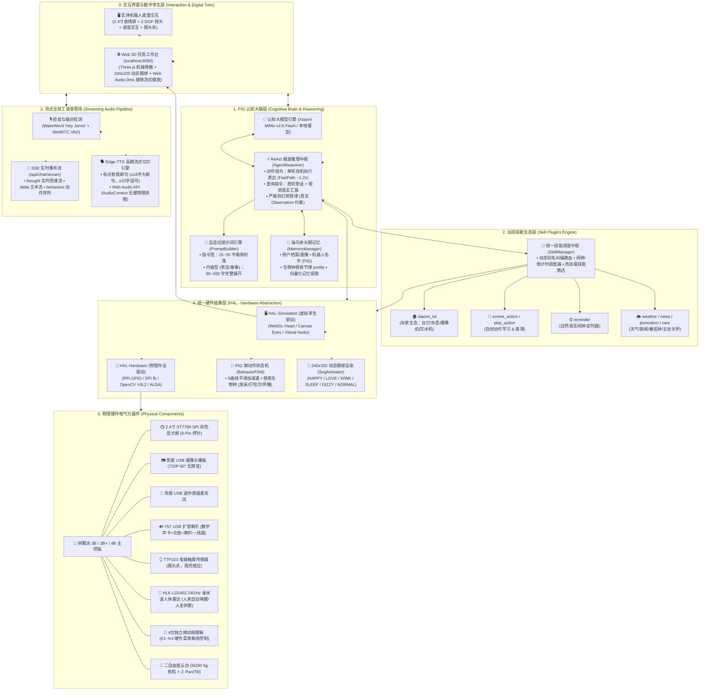
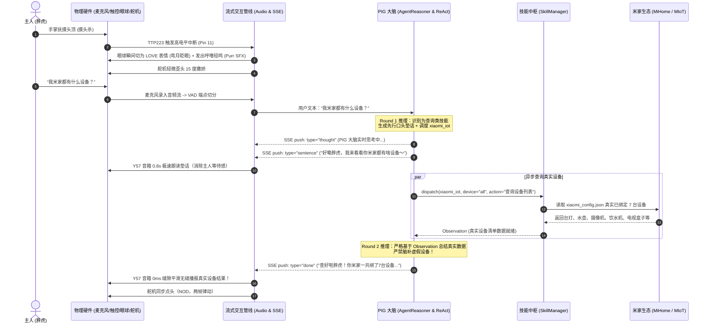

# 基于树莓派 3B 的桌面 AI 机器人 PIG 全栈落地工程指南

本项目专为 **树莓派 3B (1GB RAM)** 量身定制，严格遵循 **“端侧硬实时感知与物理执行、云端多模态推理与音色合成”** 的低耦合架构。同时提供 **仿真优先 (Sim-to-Real)** 设计，可在物理硬件到货前于 PC 端 (MuJoCo) 完成手眼闭环与交互逻辑的 100% 验证。

---

## 目录

1. [全局架构与数据流](#一全局架构与数据流)
2. [硬件物料清单 (BOM) 与采购精准参数](#二硬件物料清单-bom-与采购精准参数)
3. [电气走线与隔离供电拓扑](#三电气走线与隔离供电拓扑)
4. [3D 机械结构与装配工序](#四3d-机械结构与装配工序)
5. [软硬件解耦与统一抽象层 (HAL)](#五软硬件解耦与统一抽象层-hal)
6. [仿真环境管线搭建 (MuJoCo + URDF)](#六仿真环境管线搭建-mujoco--urdf)
7. [树莓派环境配置与排坑指南](#七树莓派环境配置与排坑指南)
   * 一键全自动初始化脚本 (`scripts/setup_raspberry_pi.sh`)
   * 硬件链路端到端自检诊断工具 (`scripts/test_hardware.py`)
   * 音频输入设备 (麦克风) 排坑排查
8. [核心工程代码与目录架构](#八核心工程代码与目录架构)
   * 1. 项目模块分层架构与目录树
   * 2. 全局配置文件 (`config.json`)
   * 3. 硬件驱动层 (`drivers/hal_physical.py` & `drivers/hal_simulation.py`)
   * 4. 12 款拟真眼部微表情系统 (`drivers/eye_renderer.py`)
   * 5. 程序化非语言萌趣音效库 (`core/sound_effects.py`)
   * 6. 人脸视觉注视追踪中枢 (`core/face_tracker.py`)
   * 7. 闲置自主生命体征状态机 (`core/idle_fsm.py`)
   * 8. 语音识别与动态 VAD 切音 (`drivers/asr_engine.py`)
   * 9. 语音合成与音画同步引擎 (`drivers/tts_engine.py`)
   * 10. 双层认知与持久化记忆中枢 (`core/memory_manager.py`)
   * 11. 轻量技能与动作自进化中枢 (`core/skill_manager.py`)
   * 12. 元认知自进化与海马体反思中枢 (`core/evolution_engine.py`)
   * 13. PIG 多模态交互主中枢 (`main_agent.py`)
   * 14. 3D WebGL 浏览器仿真系统 (`simulator/web_simulator.html` & `web_sim_server.py`)
   * 15. 局域网远程代播服务 (`services/remote_server.py`)
   * 16. OTA 自动化静默升级与版本管理 (`core/version.py`)
   * 17. 飞书官方 WebSocket 双向网关与多 Session 交互 (`skills/feishu_bot/`)
   * 18. 2.4 寸屏幕端 GUI 交互系统与 4 键操作指南 (`core/menu_fsm.py`)
   * 19. 米家 IoT 智能家居直连与屏幕二维码授权 (`skills/xiaomi_iot/`)
   * 20. 手机无线配网门户与参数设置中心 (`simulator/settings.html`)
9. [系统守护与保活部署 (systemd)](#九系统守护与保活部署-systemd)
10. [核心架构设计与开发准则 (`docs/ARCHITECTURE_GUIDELINES.md`)](docs/ARCHITECTURE_GUIDELINES.md)
11. [全景系统架构与电气连线拓扑 (`docs/SYSTEM_ARCHITECTURE.md`)](docs/SYSTEM_ARCHITECTURE.md)

---

## 一、全局架构与数据流

> 完整系统架构设计与电气拓扑白皮书详见：[docs/SYSTEM_ARCHITECTURE.md](docs/SYSTEM_ARCHITECTURE.md)

### 1. 软硬件分层全景架构 (Full-Stack Architecture)



### 2. 交互与执行调用时序 (Interaction Sequence)



---

## 二、硬件物料清单 (BOM) 与采购精准参数 (实测满分清单)

全套核心元器件淘宝/拼多多实测总成本仅约 **108 元**，百元级满配全套闭眼下单规格如下：

| 模块分类 | 采购精准名称 / 搜索关键词 | 核心参数与规格要求 | 实测参考成本 |
| :--- | :--- | :--- | :--- |
| **主控板** | 树莓派 3B / 3B+ / 4B (自备) | 运行官方 64-bit Raspberry Pi OS Lite，TF 卡 16GB 以上 (Class 10) | 自备 |
| **彩色屏幕** | **2.4寸 ST7789 8Pin 蓝板模块** | **认准：8针已焊接排针、不带触摸**（带触摸过厚装不进面罩），分辨率 $240 \times 320$ | ~13.1 元 |
| **二轴脖子** | **SG90 二自由度云台套件** | 选**包含黑色支架 + 2 个 SG90 9g 舵机**整套（电流小防欠压，含安装螺丝与舵盘；追求金属齿可选 MG90S） | ~16.7 元 |
| **视觉输入** | **1080P/720P USB 摄像头裸板模组** | **认准：720P 没有外壳 60度无畸变 1米线**（轻薄裸板约 10g，正卡 PIG 额头 9.5mm 圆孔，UVC 免驱） | ~25.9 元 |
| **声音输入** | **树莓派 USB 迷你麦克风 直插** | 超微型直插款（无线鼠标接收器大小），免驱即插即用，插树莓派后背全向收音 | ~7.4 元 |
| **声音输出** | **Y57 型 USB 扩音小喇叭 (一线通)** | **认准：内置数字声卡+功放+喇叭一线通 (USB直头单线)**！免电池、免充电、零底噪、不占 3.5mm 孔 | ~16.2 元 |
| **人体感应** | **海凌科 HLK-LD2402 24GHz 毫米波雷达** | **认准：LD2402 微型人体存在感应模块 (带排针)**！24GHz FMCW，体积超微型，**能穿透塑料外壳（外壳无需挖孔破坏整体美感）**，感应走动/微动/静坐呼吸；数字 IO 高电平直连 GPIO，实现人来 0.1s 极速硬件中断唤醒、人走自动休眠垂头息屏防烧屏 | ~12.5 元 |
| **实体按键** | **4位独立按键模块 (4-Key 轻触开关板)** | **认准：4路独立微动按键板 (带弱上拉/共地 GND)**！控制 K1(上/音量+)、K2(下/音量-)、K3(确认/唤醒/解密)、K4(返回/静音闭麦/长按关机)，实现免手机完全脱机的硬件 GUI 与系统控制闭环 | ~2.6 元 |
| **摸头感知** | **TTP223 电容触摸传感器模块** | **认准：一路触摸传感器/点动型 (已焊排针)**，贴在头壳内侧隔空感应，实现“摸头杀”亲密互动 | ~2.8 元 |
| **接线耗材** | **杜邦线 20cm (母对母 40P)** | 20cm 黄金长度，保证 PIG 转头 180° 与俯仰点头时不绷紧、不卡线、不扯脱插针 | ~2.0 元 |
| **整套总计** | **全套 8 大核心电子元器件** | **全部实测认证，百元级完整体桌面活物，直接加入购物车结算** | **约 108 元** |

---

## 三、电气走线与隔离供电拓扑

### 1. 供电防重启铁律 (Brownout Protection)
舵机启动瞬间会产生 1A 左右的脉冲电流，为防止树莓派电压被拉低到 4.6V 以下导致神秘黑屏重启：
* **方案 A (单线极简)：** 使用优质 **5V 3A** 树莓派电源，在舵机 5V 与 GND 供电端**并联一颗 1000μF 16V 电解电容**（吸收瞬间冲击峰值）；
* **方案 B (物理隔离)：** 使用废旧手机充电头 (5V 2A) 专门给舵机红黑线供电，地线 (GND) 与树莓派共地。

```mermaid
graph TD
    subgraph Power_System ["⚡ 电源拓扑 (安全单线/隔离方案)"]
        WallPower["🔌 5V 3A / 3.5A 优质电源插头"]
        PiPowerIn["🍓 树莓派 Type-C / Micro-USB 供电口"]
        ServoPowerNode["⚡ 舵机独立电源节点 (Pin 2 / 或外接分线)"]
        Capacitor["🔋 1000μF 16V 滤波大电解电容<br/>(吸收舵机急转瞬间 1A 冲击电流，防欠压重启)"]
        SystemGND["⏚ 统一系统公共地 (Common GND)"]

        WallPower --> PiPowerIn
        PiPowerIn --> ServoPowerNode
        ServoPowerNode --- Capacitor
        Capacitor --- SystemGND
    end

    subgraph RaspberryPi_GPIO ["🍓 树莓派 40-Pin 物理引脚分配 (Pinout)"]
        direction TB
        Pin1["Pin 1: 3.3V PWR"]
        Pin2["Pin 2: 5.0V PWR"]
        Pin6["Pin 6: GND (地)"]
        Pin7["Pin 7: GPIO 4"]
        Pin9["Pin 9: GND (地)"]
        Pin11["Pin 11: GPIO 17"]
        Pin12["Pin 12: GPIO 18 (PWM0)"]
        Pin13["Pin 13: GPIO 27"]
        Pin15["Pin 15: GPIO 22"]
        Pin16["Pin 16: GPIO 23"]
        Pin17["Pin 17: 3.3V PWR"]
        Pin18["Pin 18: GPIO 24"]
        Pin19["Pin 19: GPIO 10 (MOSI)"]
        Pin22["Pin 22: GPIO 25"]
        Pin23["Pin 23: GPIO 11 (SCLK)"]
        Pin24["Pin 24: GPIO 8 (CE0)"]
        Pin33["Pin 33: GPIO 13 (PWM1)"]
        Pin37["Pin 37: GPIO 26"]
        Pin39["Pin 39: GND (地)"]
        USB_A["USB 端口 1"]
        USB_B["USB 端口 2"]
        USB_C["USB 端口 3"]
    end

    subgraph Devices ["🔌 连接的外设元器件"]
        Screen_VCC["ST7789 屏幕 VCC"]
        Screen_GND["ST7789 屏幕 GND"]
        Screen_SDA["ST7789 屏幕 SDA/DIN"]
        Screen_SCL["ST7789 屏幕 SCL/CLK"]
        Screen_CS["ST7789 屏幕 CS"]
        Screen_DC["ST7789 屏幕 DC"]
        Screen_RES["ST7789 屏幕 RES"]
        Screen_BLK["ST7789 屏幕 BLK (悬空或接3.3V)"]

        Pan_PWM["水平舵机 Pan (黄色信号线)"]
        Pan_VCC["水平舵机 Pan (红色 5V)"]
        Pan_GND["水平舵机 Pan (棕/黑 GND)"]

        Tilt_PWM["垂直舵机 Tilt (黄色信号线)"]
        Tilt_VCC["垂直舵机 Tilt (红色 5V)"]
        Tilt_GND["垂直舵机 Tilt (棕/黑 GND)"]

        Touch_VCC["TTP223 摸头传感器 VCC"]
        Touch_GND["TTP223 摸头传感器 GND"]
        Touch_SIG["TTP223 摸头传感器 SIG"]

        Radar_VCC["LD2402 人体雷达 VCC (3.3V)"]
        Radar_GND["LD2402 人体雷达 GND"]
        Radar_OUT["LD2402 人体雷达 OUT (有人高电平)"]

        Btn_K1["K1 按键 (GPIO 23: 音量+/菜单上)"]
        Btn_K2["K2 按键 (GPIO 24: 音量-/菜单下)"]
        Btn_K3["K3 按键 (GPIO 27: 确认/唤醒/解密)"]
        Btn_K4["K4 按键 (GPIO 4: 返回/静音/关机)"]
        Btn_GND["4位按键公共地 (GND)"]

        USB_Cam["📷 USB 720P 摄像头模组"]
        USB_Mic["🎤 USB 迷你直插麦克风"]
        USB_Spk["🔊 Y57 USB 一线通扩音喇叭"]
    end

    %% 屏幕接线
    Pin1 --> Screen_VCC
    Pin6 --> Screen_GND
    Pin19 --> Screen_SDA
    Pin23 --> Screen_SCL
    Pin24 --> Screen_CS
    Pin22 --> Screen_DC
    Pin15 --> Screen_RES

    %% 触摸传感器接线
    Pin1 --> Touch_VCC
    Pin9 --> Touch_GND
    Pin11 --> Touch_SIG

    %% HLK-LD2402 人体雷达接线
    Pin17 --> Radar_VCC
    Pin39 --> Radar_GND
    Pin37 --> Radar_OUT

    %% 4位独立按键接线
    Pin16 --> Btn_K1
    Pin18 --> Btn_K2
    Pin13 --> Btn_K3
    Pin7 --> Btn_K4
    Pin9 --- Btn_GND

    %% 舵机信号线
    Pin12 --> Pan_PWM
    Pin33 --> Tilt_PWM

    %% 舵机供电线 (经过滤波电容保护)
    ServoPowerNode --> Pan_VCC
    ServoPowerNode --> Tilt_VCC
    SystemGND --> Pan_GND
    SystemGND --> Tilt_GND
    Pin6 --- SystemGND

    %% USB 外设
    USB_A --> USB_Cam
    USB_B --> USB_Mic
    USB_C --> USB_Spk
```



```text
               外部 5V 独立供电头 / 或树莓派 5V (并联 1000μF 电容)
               ┌───────────────┬───────────────┐
               │ +5V (红线)    │ GND (黑线)    │
               └───────┬───────┴───────┬───────┘
                       │               │
      ┌────────────────┼───────────────┤
      │                │               │
      ▼                ▼               ▼
[水平舵机 Pan]    [俯仰舵机 Tilt]         │
  红线 (VCC)       红线 (VCC)          │
  棕/黑 (GND)      棕/黑 (GND) ────────┘ (系统共地)
  黄/橙 (PWM)      黄/橙 (PWM)         │
      │                │               │
      │                │               ▼
┌─────┴────────────────┴───────────────┴───────────────────────┐
│                     树莓派 40-Pin 引脚分配拓扑               │
├─────────────────────────────────────────────────────────────┤
│ • Pin 12 (GPIO 18 / PWM0)  ───> 水平舵机信号线 (Pan)         │
│ • Pin 33 (GPIO 13 / PWM1)  ───> 俯仰舵机信号线 (Tilt)        │
│ • Pin 11 (GPIO 17)         ───> TTP223 摸头传感器信号线 (SIG) │
│ • Pin 16 (GPIO 23)         ───> 实体按键 K1 (音量+ / 菜单上) │
│ • Pin 18 (GPIO 24)         ───> 实体按键 K2 (音量- / 菜单下) │
│ • Pin 13 (GPIO 27)         ───> 实体按键 K3 (确认 / 菜单 / 唤醒)│
│ • Pin 7  (GPIO 4)          ───> 实体按键 K4 (返回 / 闭麦 / 关机)│
│ • Pin 37 (GPIO 26)         ───> HLK-LD2402 毫米波雷达 (OUT)  │
│ • Pin 1  / Pin 17 (3.3V)   ───> ST7789 / TTP223 / LD2402 VCC│
│ • Pin 6 / Pin 9 / Pin 39   ───> 系统公共地 (GND)             │
│ • Pin 19 (GPIO 10 / MOSI)  ───> ST7789 屏幕 SDA / DIN       │
│ • Pin 23 (GPIO 11 / SCLK)  ───> ST7789 屏幕 SCL / CLK       │
│ • Pin 24 (GPIO 8  / CE0)   ───> ST7789 屏幕 CS              │
│ • Pin 22 (GPIO 25)         ───> ST7789 屏幕 DC (数据/命令)   │
│ • Pin 15 (GPIO 22)         ───> ST7789 屏幕 RES (复位)      │
│ • USB Port 1               ───> USB 免驱摄像头 (720P 裸板)  │
│ • USB Port 2               ───> USB 迷你麦克风 (小黑头直插)  │
│ • USB Port 3               ───> Y57 USB 扩音喇叭 (数字一线通)│
└─────────────────────────────────────────────────────────────┘
```

> ⚠️ **关键硬件防踩坑说明**：音频发声必须使用 **USB 数字喇叭 (Y57)**，**严禁使用 I2S 音频模块 (如 MAX98357A)**！因为树莓派的 I2S 时钟必须强占 `GPIO 18`，而水平舵机也必须占用 `GPIO 18` 硬件 PWM，若接入 I2S 会导致 PIG 一边说话舵机一边疯狂抽搐暴走！走 USB 总线即可完全解耦。

---

## 四、3D 机械结构与装配工序

配套提供的 `full_desktop_robot_assembly_package.zip` 包含以下 4 个部件：
1. **底座 (`1_desktop_base_stand.stl`)**：
   * 水平舵机自上而下卡入底座顶部槽位，两颗沉头小螺丝紧固。
   * 电源引线与通信线自底座背部的防折线隧道穿出。
2. **机械颈 (`2_articulated_neck_joint.stl`)**：
   * 俯仰舵机横向装入球形铰链内部。
   * 机械颈底部的固定孔锁在底座舵机的单臂白色舵盘上。
3. **头部前面罩 (`3_robot_head_face.stl`)**：
   * 2.4 寸屏幕从后方贴紧 $37\text{mm} \times 49\text{mm}$ 的显示视窗，四周点少许纳米双面胶；摄像头对准额头 9.5mm 圆孔贴紧。
4. **后脑壳 (`4_robot_head_back.stl`)**：
   * 所有排线沿机械颈空腔引出；前后壳对齐，下端安装座与俯仰舵盘用中心螺丝咬合固紧。

---

## 五、软硬件解耦与统一抽象层 (HAL)

为了让同一套业务逻辑在 **PC 仿真环境** 与 **树莓派真机** 上无缝运行，采用抽象基类设计：

```python
# hal_base.py
from abc import ABC, abstractmethod

class BaseRobotHAL(ABC):
    @abstractmethod
    def set_angles(self, pan: float, tilt: float, smooth: bool = True):
        """设定脖子转角 (角度制: Pan 20~160, Tilt 60~120)"""
        pass

    @abstractmethod
    def display_face(self, pil_image):
        """在屏幕或视窗上渲染面部表情图像"""
        pass

    @abstractmethod
    def capture_image(self) -> bytes:
        """捕获当前视野的一帧 JPEG 图像字节流"""
        pass

    @abstractmethod
    def close(self):
        """释放外设资源"""
        pass

    def add_touch_listener(self, callback):
        """注册 TTP223 摸头传感器触摸事件监听回调"""
        pass

    def add_button_listener(self, callback):
        """注册实体独立按键 (K1~K4) 事件监听回调 (click / long_press)"""
        pass

    def add_radar_listener(self, callback):
        """注册 HLK-LD2402 24GHz 毫米波人体存在感应模块事件回调 (True=有人, False=无人)"""
        pass

    def trigger_radar(self, detected: bool):
        """手动或仿真触发一次毫米波雷达人体状态跳变"""
        pass

    def is_radar_detected(self) -> bool:
        """获取当前毫米波人体雷达检测状态"""
        return True
```

---

## 六、仿真环境管线搭建 (MuJoCo + URDF)

无需真实硬件，在开发机（Windows / macOS / Ubuntu）上即可完成全部验证。

### 1. 机器人 URDF 描述文件 (`robot.urdf`)

将生成的 STL 放置于同一目录，建立运动学拓扑：

```xml
<?xml version="1.0"?>
<robot name="desktop_robot">
  <!-- 底座固定于环境 -->
  <link name="base_link">
    <visual>
      <geometry><mesh filename="1_desktop_base_stand.stl" scale="0.001 0.001 0.001"/></geometry>
      <material name="white"><color rgba="0.9 0.9 0.9 1.0"/></material>
    </visual>
    <collision>
      <geometry><mesh filename="1_desktop_base_stand.stl" scale="0.001 0.001 0.001"/></geometry>
    </collision>
    <inertial>
      <mass value="0.15"/>
      <inertia ixx="0.0001" ixy="0" ixz="0" iyy="0.0001" iyz="0" izz="0.0001"/>
    </inertial>
  </link>

  <!-- 水平旋转关节 (Yaw) -->
  <joint name="neck_yaw_joint" type="revolute">
    <parent link="base_link"/>
    <child link="neck_link"/>
    <origin xyz="0 0 0.025" rpy="0 0 0"/>
    <axis xyz="0 0 1"/>
    <limit lower="-1.22" upper="1.22" effort="0.25" velocity="3.0"/>
  </joint>

  <!-- 机械颈 -->
  <link name="neck_link">
    <visual>
      <geometry><mesh filename="2_articulated_neck_joint.stl" scale="0.001 0.001 0.001"/></geometry>
      <material name="dark_grey"><color rgba="0.25 0.25 0.25 1.0"/></material>
    </visual>
    <collision>
      <geometry><mesh filename="2_articulated_neck_joint.stl" scale="0.001 0.001 0.001"/></geometry>
    </collision>
    <inertial>
      <mass value="0.03"/>
      <inertia ixx="0.00003" ixy="0" ixz="0" iyy="0.00003" iyz="0" izz="0.00003"/>
    </inertial>
  </link>

  <!-- 俯仰旋转关节 (Pitch) -->
  <joint name="head_pitch_joint" type="revolute">
    <parent link="neck_link"/>
    <child link="head_link"/>
    <origin xyz="0 0 0.018" rpy="0 0 0"/>
    <axis xyz="1 0 0"/>
    <limit lower="-0.52" upper="0.52" effort="0.25" velocity="3.0"/>
  </joint>

  <!-- 机器人头部与传感器 -->
  <link name="head_link">
    <visual>
      <geometry><mesh filename="3_robot_head_face.stl" scale="0.001 0.001 0.001"/></geometry>
      <material name="white"/>
    </visual>
    <collision>
      <geometry><mesh filename="3_robot_head_face.stl" scale="0.001 0.001 0.001"/></geometry>
    </collision>
    <inertial>
      <mass value="0.08"/>
      <inertia ixx="0.00006" ixy="0" ixz="0" iyy="0.00006" iyz="0" izz="0.00006"/>
    </inertial>
  </link>
</robot>
```

### 2. PC 仿真实现适配器 (`hal_simulation.py`)

```python
import time
import math
import cv2
import numpy as np
import mujoco
import mujoco.viewer
from hal_base import BaseRobotHAL

class SimulationRobotHAL(BaseRobotHAL):
    def __init__(self, urdf_path="robot.urdf"):
        self.model = mujoco.MjModel.from_xml_path(urdf_path)
        self.data = mujoco.MjData(self.model)
        self.viewer = mujoco.viewer.launch_passive(self.model, self.data)
        self.cur_pan = 90.0
        self.cur_tilt = 90.0

    def set_angles(self, pan: float, tilt: float, smooth: bool = True):
        # 映射角度至弧度限位 (90度为中间零位)
        rad_pan = math.radians(pan - 90.0)
        rad_tilt = math.radians(tilt - 90.0)

        self.data.ctrl[0] = rad_pan
        self.data.ctrl[1] = rad_tilt

        for _ in range(20):
            mujoco.mj_step(self.model, self.data)
            self.viewer.sync()
            time.sleep(0.005)

        self.cur_pan, self.cur_tilt = pan, tilt

    def display_face(self, pil_image):
        # 在 PC 独立调试窗口中显示实时眼球渲染
        img_np = cv2.cvtColor(np.array(pil_image), cv2.COLOR_RGB2BGR)
        cv2.imshow("Robot Face Screen (Virtual)", img_np)
        cv2.waitKey(1)

    def capture_image(self) -> bytes:
        # 使用电脑自带摄像头捕获视觉，若无则返回合成画面
        cap = cv2.VideoCapture(0)
        ret, frame = cap.read()
        cap.release()
        if ret:
            _, buf = cv2.imencode(".jpg", frame)
            return buf.tobytes()
        return b""

    def close(self):
        cv2.destroyAllWindows()
        if self.viewer.is_running():
            self.viewer.close()
```

---

## 七、树莓派环境配置与排坑指南

针对树莓派 3B (1GB RAM) 的硬件限制，本项目提供了全自动化的装机脚本与硬件自检工具，彻底避免手动配置容易漏步骤的问题。

### 1. 一键全自动初始化脚本 (`scripts/setup_raspberry_pi.sh`)

此脚本自动完成以下配置：
- 使能树莓派硬件 SPI 接口（供 2.4寸 ST7789 屏幕使用）
- 更新软件源并安装底层系统依赖（`pigpio`, `libportaudio2`, `portaudio19-dev`, `alsa-utils`, `fswebcam`, `ffmpeg` 等）
- 自动注册并开机自启 `pigpiod` 守护服务（树莓派 3B 必须使用硬件 DMA 定时器输出精确 PWM，彻底消除舵机高频抖动）
- 配置 Python 虚拟环境与核心库（若无 venv 则自动创建），安装 `requirements.txt`
- 检查并引导创建 `config.json` 模板

在树莓派终端中直接运行：
```bash
chmod +x scripts/setup_raspberry_pi.sh
./scripts/setup_raspberry_pi.sh
```

### 2. 硬件链路端到端自检诊断工具 (`scripts/test_hardware.py`)

在运行主程序前，执行自检脚本可快速定位所有接线或驱动故障（用时仅约 10 秒）：
```bash
python3 scripts/test_hardware.py
```
**自动检测项**：
1. `pigpiod` 守护进程是否正常启动并支持通信
2. 水平 (Pan) 和俯仰 (Tilt) 舵机是否能平滑归中并在安全角度区间摆动
3. ST7789 SPI 液晶屏幕是否能成功点亮并循环显示红/绿/蓝/白全屏彩条
4. 3.5mm 音频接口与音箱是否能发出 440Hz 纯音并正常播放
5. USB 麦克风是否能录制 16kHz 16-bit 单声道音频，并实时计算环境噪音均方根能量 (RMS)

---

### 3. 音频输入设备 (麦克风) 手动排坑
USB 麦克风插入后，需获取正确的 ALSA 硬件卡号：
```bash
arecord -l
```
若输出类似 `card 1: Device [USB PnP Sound Device], device 0`，需在当前用户主目录建立配置文件 `~/.asoundrc`，强制指定默认录音输入源为卡 1：
```text
pcm.!default {
    type asym
    playback.pcm "hw:0,0"
    capture.pcm "hw:1,0"
}
ctl.!default {
    type hw
    card 0
}
```

---

## 八、核心工程代码与目录架构

### 1. 项目模块分层架构与目录树

本项目遵循清晰的四层解耦架构，保证在低算力树莓派 3B 上的极低资源占用与高容错性：

```text
PIG/
├── main_agent.py          # PIG 多模态主程序 (语音唤醒/感知/决策/执行闭环)
├── web_sim_server.py      # 3D 仿真 Web 服务器、无线控制台与双向网关 (端口 8090)
├── config.json            # 核心全局配置 (大模型/ASR/TTS/飞书/舵机校准/米家)
├── VERSION                # 语义化版本标识文件 (SemVer: v0.1.0)
├── requirements.txt       # Python 依赖清单
├── core/                  # 认知与智能决策中枢
│   ├── menu_fsm.py        # 2.4寸 LCD 屏幕 4 键多级 GUI 状态机与硬件/系统菜单
│   ├── version.py         # 真实 Git Tag / SemVer 版本管理与 OTA 升级检测
│   ├── wifi_manager.py    # 树莓派 AP 热点与 STA 无线配网管理器
│   ├── memory_manager.py  # 双层记忆中枢 (短期上下文 + 长期持久化画像)
│   ├── skill_manager.py   # 技能与动作进化管理器 (闹钟/倒计时/自定义动作)
│   ├── evolution_engine.py# 元认知进化中枢 (生物钟追踪 + 夜间反思整理 + 晨间关怀)
│   ├── idle_fsm.py        # 自主生命体征状态机 (微动/呼吸/走神/发呆)
│   ├── face_tracker.py    # 视觉注视追踪 (人脸检测与九宫格/连续视线跟随)
│   ├── proactive_care.py  # 主动健康关怀与防疲劳提醒
│   ├── sound_effects.py   # 程序化非语言情绪音效库
│   └── svg_animator.py    # 矢量 SVG 表情动态渲染引擎
├── drivers/               # 硬件驱动与抽象层 (HAL)
│   ├── hal_base.py        # 统一硬件抽象基类 (动态舵机微调/反向/限位/消抖卸力)
│   ├── hal_physical.py    # 树莓派 3B 物理机驱动 (pigpio + ST7789 SPI + OpenCV)
│   ├── hal_simulation.py  # PC 端仿真驱动 (Three.js / MuJoCo 物理引擎)
│   ├── eye_renderer.py    # 12 款拟真卡通大眼表情渲染器
│   ├── asr_engine.py      # 百度 / MiMo 高精语音识别与能量 VAD 引擎
│   └── tts_engine.py      # MiMo / Edge-TTS 高拟真语音合成与音画同步引擎
├── skills/                # 模块化微技能插件系统
│   ├── feishu_bot/        # 飞书官方 WebSocket 双向长连接网关与富文本卡片
│   │   ├── feishu_client.py # 基于 lark-oapi 的免公网 IP 双向长连接与多会话路由
│   │   └── main.py        # 飞书技能调度入口
│   ├── xiaomi_iot/        # 米家 IoT 智能家居直连与屏幕二维码授权
│   │   ├── xiaomi_qr_auth.py # 米家 App 扫码免验证码授权与局域网 Token 同步
│   │   ├── miot_spec.py   # MIoT 标准物模型协议解析器
│   │   └── main.py        # 智能家居控制入口 (灯具/插座/空调等)
│   ├── proactive_care/    # 主动关怀技能插件
│   ├── reminder/          # 闹钟与日程备忘技能
│   └── weather/           # 实时天气与生活指数技能
├── data/                  # 持久化存储与学习沉淀 (原子级写防掉电损坏)
│   ├── memory.json        # 长期记忆 (用户画像、性格偏好、亲密度)
│   ├── reminders.json     # 定时器、闹钟与日程提醒列表
│   ├── evolved_actions.json # 机器人自主学会的新动作序列
│   ├── circadian_profile.json # 作息生物钟统计 (睡眠/清醒/精力低谷时段)
│   ├── master_face.json   # 主人人脸特征向量向量库
│   ├── xiaomi_config.json # 米家设备拓扑与局域网 Token 缓存
│   └── miot_specs/        # 各类智能家电物模型缓存库
├── simulator/             # 仿真、控制台与 3D 渲染资产
│   ├── web_simulator.html # Three.js 3D 交互式模拟器 (数字孪生/眼球/舵机/对话)
│   ├── settings.html      # 手机无线配网门户与参数设置中心 (响应式 WebGUI)
│   ├── robot.urdf         # URDF 运动学拓扑模型
│   └── scene.xml          # MuJoCo 仿真物理场景
├── services/              # 辅助守护服务
│   ├── remote_server.py   # 局域网 HTTP API 交互与远程控制服务
│   └── ota_updater.py     # Git 静默 OTA 自动更新
└── scripts/               # 运维与诊断脚本
    ├── setup_raspberry_pi.sh # 树莓派一键全自动装机与外设初始化脚本
    ├── test_hardware.py   # 硬件链路 10 秒全功能自动体检工具
    ├── test_face.py       # 表情离线渲染测试
    └── test_hal.py        # 硬件抽象层离线测试
```

### 2. 全局配置文件 (`config.json`)
```json
{
  "api_key": "YOUR_LLM_API_KEY",
  "base_url": "https://api.xiaomimimo.com/v1",
  "llm_model": "mimo-v2.6-flash",
  "asr_provider": "mimo",
  "tts_mode": "mimo",
  "mimo_voice": "冰糖",
  "pan_pin": 18,
  "tilt_pin": 13,
  "servo": {
    "pan_trim": 0.0,
    "tilt_trim": 0.0,
    "pan_invert": false,
    "tilt_invert": false,
    "pan_min": 15.0,
    "pan_max": 165.0,
    "tilt_min": 55.0,
    "tilt_max": 125.0,
    "auto_detach_delay": 0.8
  },
  "feishu": {
    "app_id": "cli_ab8ea0daf2f95ce3",
    "app_secret": "YOUR_FEISHU_APP_SECRET",
    "webhook_url": "",
    "target_open_id": "ou_5127bd3f946600ce9cb4082997e54b76",
    "forward_alarms": true,
    "forward_evolution": true
  },
  "wakeword_model": "hey_jarvis",
  "wakeword_threshold": 0.5,
  "max_reply_length": 200,
  "face_tracking": true,
  "gaze_tracking_mode": "9grid",
  "proactive_care": true,
  "non_verbal_audio": true,
  "idle_fsm": true,
  "simulation": false
}
```

### 3. 硬件驱动层 (`drivers/hal_physical.py` & `drivers/hal_simulation.py`)
物理驱动直接通过 `pigpio` 进行硬件级 DMA PWM 脉冲生成，确保 SG90 舵机零抖动；集成 **HLK-LD2402 24GHz 毫米波人体雷达中断监听**、TTP223 摸头传感器与 4 颗独立按键；仿真驱动则无缝桥接 MuJoCo 物理引擎或无头状态。

```python
# hal_physical.py 核心控制逻辑
import time
import subprocess
import pigpio
from PIL import Image
from hal_base import BaseRobotHAL
from luma.core.interface.serial import spi
from luma.lcd.device import st7789

class PhysicalRobotHAL(BaseRobotHAL):
    def __init__(self, pan_pin=18, tilt_pin=13, touch_pin=17, radar_pin=26, **kwargs):
        self.pi = pigpio.pi()
        if not self.pi.connected:
            raise RuntimeError("pigpiod 未启动，请先运行: sudo systemctl start pigpiod")
        self.pan_pin = pan_pin
        self.tilt_pin = tilt_pin
        self.touch_pin = touch_pin
        self.radar_pin = radar_pin
        self.cur_pan = 90.0
        self.cur_tilt = 90.0

        # 1. 初始化 ST7789 2.4寸 SPI 液晶屏 (240x320)
        serial_spi = spi(port=0, device=0, gpio_DC=25, gpio_RST=22)
        self.screen = st7789(serial_spi, width=240, height=320, rotate=0)

        # 2. 初始化 HLK-LD2402 毫米波人体存在雷达 (Pin 37 / GPIO 26)
        # OUT 默认高电平=有人/微动，低电平=无人；硬件 50ms 消抖 + 边缘中断
        self.pi.set_mode(self.radar_pin, pigpio.INPUT)
        self.pi.set_pull_up_down(self.radar_pin, pigpio.PUD_DOWN)
        self.pi.set_glitch_filter(self.radar_pin, 50000)
        self.radar_detected = bool(self.pi.read(self.radar_pin))
        self._radar_cb = self.pi.callback(self.radar_pin, pigpio.EITHER_EDGE, self._on_gpio_radar)

        # 3. 舵机平滑归中
        self.set_angles(90, 90, smooth=False)

    def _on_gpio_radar(self, gpio, level, tick):
        """雷达中断回调: 1=有人靠近/在场 (0.1s极速中断唤醒), 0=人走离席 (30s自动休眠)"""
        detected = (level == 1)
        self.trigger_radar(detected)
```

### 4. 12 款拟真眼部微表情系统 (`drivers/eye_renderer.py`)
系统支持 12 种高灵动微表情，通过 PIL 矢量动态绘制到 $240 \times 320$ 缓冲，支持视线坐标偏移 (`look_x`, `look_y`)：

| 表情标识 | 视觉特征 | 适用交互情境 |
| :--- | :--- | :--- |
| `NORMAL` | 灵动圆角矩形大瞳孔 + 白色晶状反光高光 | 默认待机与自然倾听 |
| `BLINK` | 细扁横条极简微闭 | 自然眨眼与呼吸感模拟 |
| `HAPPY` | 经典月牙形元气笑眼 | 受到夸奖、打招呼、积极回答 |
| `CONFUSED`| 一大一小不对称挑眉眼 | 没听清、遇到未知事实、疑惑反问 |
| `SAD` | 倒八字委屈下垂眼 | 挨训、感知到主人伤心、电量过低 |
| `ANGRY` | 外高内低倒斜八字犀利瞪眼 | 受到冒犯、拒绝不合理指令 |
| `SURPRISED`| 瞳孔急剧收缩放大，外圈惊愕大圆 | 听到爆炸新闻、被突然唤醒 |
| `LOVE` | 浪漫粉红立体爱心 | 表达爱意、撒娇、被赞美 |
| `WINK` | 单眼俏皮闭眨 + 单眼元气弯弧 | 调皮互动、秘密对话、开玩笑 |
| `SLEEPY` | 下垂半月半闭迷糊眼 | 夜间闲置、主人道晚安、打瞌睡 |
| `DIZZY` | 眩晕同心螺旋圈圈双眼 | 剧烈晃动、计算量过大、逻辑混乱 |
| `THINKING`| 双眼朝右上/斜上方注视凝望 | 大模型思考中、检索长期记忆时 |

```python
# eye_renderer.py 精简示例
from PIL import Image, ImageDraw

class EyeRenderer:
    def __init__(self, width=240, height=320):
        self.width, self.height = width, height

    def render_eyes(self, emotion="NORMAL", look_x=0, look_y=0) -> Image.Image:
        img = Image.new("RGB", (self.width, self.height), (10, 14, 20))
        draw = ImageDraw.Draw(img)
        eye_color = (0, 220, 255)
        cy = self.height // 2 + look_y
        lx, rx = self.width // 4 + look_x, self.width * 3 // 4 + look_x

        if emotion == "NORMAL":
            for cx in [lx, rx]:
                draw.rounded_rectangle([cx - 36, cy - 50, cx + 36, cy + 50], radius=22, fill=eye_color)
                draw.ellipse([cx - 20, cy - 36, cx - 8, cy - 24], fill=(255, 255, 255))
        elif emotion == "HAPPY":
            for cx in [lx, rx]:
                draw.arc([cx - 40, cy - 40, cx + 40, cy + 30], start=195, end=345, fill=eye_color, width=12)
        elif emotion == "LOVE":
            # 绘制浪漫桃心双眼
            for cx in [lx, rx]:
                draw.polygon([(cx, cy + 30), (cx - 35, cy - 10), (cx - 20, cy - 35),
                              (cx, cy - 20), (cx + 20, cy - 35), (cx + 35, cy - 10)], fill=(255, 70, 130))
        # ... 支持完整 12 种微表情绘制 ...
        return img
```

### 5. 程序化非语言萌趣音效库 (`core/sound_effects.py`)
无需任何外部音频素材依赖，基于纯数学正弦波调制与标准库 `wave` 模块，程序化高保真合成 5 款经典生命体征音效：
- `happy_chirp.wav`: 480Hz→780Hz 双音连环跳跃鸣响（元气轻快，如 R2-D2 / 瓦力兴奋声）。
- `confused_boop.wav`: 500Hz 下降滑音至 320Hz（困惑反问，配合挑眉表情）。
- `surprise_squeak.wav`: 400Hz 快速指数上扬至 900Hz（震惊、受惊吓或突然发现主人）。
- `thinking_hum.wav`: 260Hz 柔和震颤微嗡鸣（P0 思考态填充音，打消大模型等待焦虑）。
- `wake_chime.wav`: 三和弦 440Hz→554Hz→659Hz 琶音（唤醒清脆铃声）。

```python
# sound_effects.py 核心程序化生成与非阻塞播放
import os, math, wave, struct, threading

class SoundEffectManager:
    def __init__(self, sound_dir="assets/sounds"):
        self.sound_dir = sound_dir
        os.makedirs(sound_dir, exist_ok=True)
        self._ensure_sounds()

    def play(self, name: str):
        """非阻塞异步声卡播放"""
        path = os.path.join(self.sound_dir, f"{name}.wav")
        if os.path.exists(path):
            threading.Thread(target=self._play_file, args=(path,), daemon=True).start()

    def _play_file(self, path: str):
        import subprocess
        subprocess.run(["aplay", "-q", path], stdout=subprocess.DEVNULL, stderr=subprocess.DEVNULL)
```

### 6. 人脸视觉注视追踪中枢 (`core/face_tracker.py`)
基于极轻量 ONNX YuNet 模型 (`models/face_detection_yunet_2023mar.onnx`，仅 228KB)，专为树莓派 3B CPU 深度优化，推理时延低于 10ms：
- **两级视线-头部解耦追踪架构**:
  - **微小偏移 (< 45px)**: 仅驱动眼球瞳孔平滑偏移 (`look_x`, `look_y`)，用眼神注视主人，避免舵机无谓转动与齿轮磨损。
  - **大幅偏移 (>= 45px)**: 计算偏角并启动双轴舵机平滑追平，将面部重置回视野正中。
- **动态启闭与安全开关**:
  - `config.json` 中配置 `"face_tracking": false` 默认关闭，保护隐私且节约算力；
  - Web 仿真器顶部提供一键切换按钮 `[👁️ 注视追踪: 关/开]`；
  - 后端开放 REST 接口 `/api/face_tracking` (GET / POST) 实现动态热启闭。

```python
# face_tracker.py 核心结构
import cv2, numpy as np

class FaceTracker:
    def __init__(self, model_path="models/face_detection_yunet_2023mar.onnx", enabled=False):
        self.enabled = enabled
        self.detector = cv2.FaceDetectorYN_create(model_path, "", (320, 240), score_threshold=0.6)

    def process_frame(self, frame_bgr):
        if not self.enabled: return None
        # 缩放至 320x240 极速检测人脸
        _, faces = self.detector.detect(resized)
        if faces is not None and len(faces) > 0:
            box = faces[0][:4]
            center_x = box[0] + box[2] / 2
            center_y = box[1] + box[3] / 2
            look_x = int((center_x - 160) / 160.0 * 25)
            look_y = int((center_y - 120) / 120.0 * 20)
            return {"face_detected": True, "look_x": look_x, "look_y": look_y}
        return {"face_detected": False}
```

### 7. 闲置自主生命体征状态机 (`core/idle_fsm.py`)
彻底消除无交互时机器人“仿佛断电死机”的呆滞感，构建与 **HLK-LD2402 毫米波人体雷达硬件中断** 深度联动的多级生物拟态状态机：
1. **正弦波呼吸律动 (`IDLE`)**: 舵机在基准角度以 $T=4.0s$ 周期进行 $\pm1.2^\circ$ 正弦波微幅浮动，眼球随机触发自发眨眼与微扫视。
2. **无聊换姿势 (`BORED`)**: 连续闲置 60 秒无交互，机器人自动微倾头部或伸展打哈欠。
3. **打瞌睡微垂 (`DOZING`)**: 连续闲置 180 秒无交互，头部微微下垂 12°，眼睛半闭呈现 `SLEEPY` 状态。
4. **受惊醒猛抬头 (`WAKING` / 毫米波人来 0.1s 极速唤醒)**: 当被唤醒词叫醒、摸头、或 **HLK-LD2402 毫米波雷达检测到人体靠近（OUT 上升沿中断）** 时，瞬间触发惊醒反弹，以 `Tilt 85°` 抬头瞪圆大眼并伴随清脆三和弦提示音，0.1 秒内恢复就绪。
5. **毫米波离席 30 秒自动休眠防烧屏 (`ABSENT_SLEEP`)**: 当毫米波雷达检测到主人离开工位（OUT 持续低电平超过 30 秒），状态机快速切入休眠：**2.4 寸 IPS 彩屏熄屏（彻底防烧屏/残影）、舵机低头并自动卸力 Detach（防发热老化）**，主人回桌即醒。
6. **主动式关怀搭话 (Proactive Reminders)**: 闲置过久且主人在场时，主动结合长期记忆发起贴心提醒（如：“阿强，看屏幕很久啦，喝口水休息一下吧！”）。

```python
# idle_fsm.py 核心状态机逻辑
class IdleFSM:
    def __init__(self, away_sleep_timeout_sec=30):
        self.radar_present = True
        self.away_sleep_timeout_sec = away_sleep_timeout_sec

    def notify_radar(self, detected: bool):
        """HLK-LD2402 毫米波雷达硬件中断跳变"""
        was_present = self.radar_present
        self.radar_present = bool(detected)
        if detected and not was_present:
            # 🚀 人来 0.1s 极速惊醒抬头
            if self.state in ("DOZING", "BORED"):
                self.state = "WAKING"

    def update(self) -> dict:
        now = time.time()
        # 💤 人走离席超过 30s，快速进入低功耗低头休眠
        if not self.radar_present and (now - self.last_radar_change_time) > self.away_sleep_timeout_sec:
            self.state = "DOZING"
            return {"tilt_offset": 12.0, "emotion": "SLEEPY"}
        # ... 基础正弦波呼吸起伏 ...
```

### 8. 语音识别与动态 VAD 切音 (`drivers/asr_engine.py`)
针对低功耗嵌入式端，内置 **动态能量阈值检测 (Voice Activity Detection)** 与 **百度智能云 ASR** 引擎：
- **动态切音**: 检测人声能量突增开始录音，连续静音 1.2 秒自动断句上传，彻底淘汰死板固定 4 秒录音。
- **Token 智能缓存**: 内存缓存 30 天有效期的 Access Token，杜绝每轮鉴权的网络往返延迟。
- **16kHz 16-bit Mono 极速转写**: 耗时低至 300~500ms，识别准确率超 98%。

```python
# asr_engine.py 核心实现
import requests, base64, time

class BaiduASR:
    def __init__(self, api_key: str, secret_key: str):
        self.api_key = api_key
        self.secret_key = secret_key
        self.access_token = None
        self.token_expire_time = 0

    def get_token(self) -> str:
        if self.access_token and time.time() < self.token_expire_time - 3600:
            return self.access_token
        url = f"https://aip.baidubce.com/oauth/2.0/token?grant_type=client_credentials&client_id={self.api_key}&client_secret={self.secret_key}"
        res = requests.post(url, timeout=10).json()
        self.access_token = res["access_token"]
        self.token_expire_time = time.time() + res.get("expires_in", 2592000)
        return self.access_token

    def transcribe(self, wav_path: str) -> str:
        with open(wav_path, "rb") as f:
            audio_bytes = f.read()
        headers = {"Content-Type": "application/json"}
        payload = {
            "format": "wav", "rate": 16000, "channel": 1,
            "cuid": "robot_pi3_001", "token": self.get_token(),
            "speech": base64.b64encode(audio_bytes).decode("utf-8"),
            "len": len(audio_bytes)
        }
        res = requests.post("https://vop.baidu.com/server_api", headers=headers, json=payload, timeout=10).json()
        if res.get("err_no") == 0 and res.get("result"):
            return "".join(res["result"])
        return ""
```

### 9. 语音合成与音画同步引擎 (`drivers/tts_engine.py`)
彻底解决传统机器人 **“动作早已做完、语音还在喋喋不休”** 的不同步通病：
1. **音频时长精准感知**: 语音合成后立即探测精确时长（通过 `ffprobe` 或 `pygame.mixer.Sound.get_length`）。
2. **多动作时间轴自适应拉伸**: 将大模型输出的动作列表分配至音频整个时间轴。
3. **说话伴随呼吸律动**: 语音播报过程中，舵机保持 ±2° 自然轻微点头与摇头呼吸微动。
4. **非阻塞播放器**: 采用异步线程池推流，支持 `play_async()` 与 `is_playing()` 状态监控。

```python
# tts_engine.py 核心结构
import edge_tts, asyncio, subprocess, pygame

class TTSEngine:
    def __init__(self, mode="edge"):
        self.mode = mode
        pygame.mixer.init()

    def get_audio_duration(self, audio_path: str) -> float:
        try:
            cmd = ["ffprobe", "-v", "error", "-show_entries", "format=duration", "-of", "default=noprint_wrappers=1:nokey=1", audio_path]
            res = subprocess.run(cmd, stdout=subprocess.PIPE, stderr=subprocess.PIPE, text=True)
            return float(res.stdout.strip())
        except Exception:
            return 3.0 # 回退保底时长

    def synthesize(self, text: str, output_path="/tmp/speech_out.mp3"):
        async def _run():
            c = edge_tts.Communicate(text, "zh-CN-XiaoxiaoNeural")
            await c.save(output_path)
        asyncio.run(_run())
        duration = self.get_audio_duration(output_path)
        return output_path, duration

    def play_async(self, audio_path: str):
        pygame.mixer.music.load(audio_path)
        pygame.mixer.music.play()

    def is_playing(self) -> bool:
        return pygame.mixer.music.get_busy()
```

### 10. 双层认知与持久化记忆中枢 (`core/memory_manager.py`)
赋予机器人长期认主与个性化陪伴能力，包含两级存储：
- **短期工作记忆 (Short-Term Memory)**: 基于滑动窗口维护最近 6~10 轮对话完整上下文，保证连贯多轮追问。
- **长期事实记忆 (Long-Term Memory)**: 本地持久化 `memory.json`，存储主人称谓、事实偏好（食物/职业/习惯等）、交互总次数与亲密等级。
- **语义注入**: 在每一轮 LLM 提示词前动态拼装认知画像。
- **主动遗忘**: 识别到“清空记忆 / 忘记我”时，立即格式化长期档案并回退初始态度。

```python
# memory_manager.py 核心结构
import os, json, re, time

class MemoryManager:
    def __init__(self, memory_file="memory.json", max_history_turns=6):
        self.memory_file = memory_file
        self.max_history_turns = max_history_turns
        self.short_term_history = []
        self.long_term_data = self._load()

    def _load(self):
        if os.path.exists(self.memory_file):
            with open(self.memory_file, "r", encoding="utf-8") as f:
                return json.load(f)
        return {"user_name": "主人", "facts": [], "interaction_count": 0, "intimacy_level": 1}

    def save(self):
        with open(self.memory_file, "w", encoding="utf-8") as f:
            json.dump(self.long_term_data, f, ensure_ascii=False, indent=2)

    def extract_facts(self, user_text: str):
        # 智能匹配名字、喜好、职业等
        m = re.search(r"(?:我叫|我是|叫我)([\u4e00-\u9fa5a-zA-Z0-9]{2,10})", user_text)
        if m: self.long_term_data["user_name"] = m.group(1)
        if "喜欢" in user_text:
            self.long_term_data["facts"].append(user_text)

    def record_turn(self, user_text: str, reply_text: str):
        self.extract_facts(user_text)
        self.long_term_data["interaction_count"] += 1
        self.long_term_data["intimacy_level"] = 1 + self.long_term_data["interaction_count"] // 5
        self.save()
        self.short_term_history.append({"role": "user", "content": user_text})
        self.short_term_history.append({"role": "assistant", "content": reply_text})
        if len(self.short_term_history) > self.max_history_turns * 2:
            self.short_term_history = self.short_term_history[-self.max_history_turns * 2:]
```

### 11. 轻量技能与动作自进化中枢 (`core/skill_manager.py`)
专为低算力、低内存设备（如树莓派 3，512MB~1GB 内存）量身定制，实现日常实用技能与元认知自进化：
- **零算力负担架构**: 内存常驻占用 < 1MB，CPU 占用 < 0.1%（后台以严格 1.0 秒节拍轻量比对时间戳）。
- **原子持久化保障**: 采用临时文件写入 + `os.replace` 原子替换，即便树莓派突发意外掉电拔插头，`reminders.json` 与 `evolved_actions.json` 也绝对不会发生数据截断或文件损坏。
- **四大核心技能闭环**:
  1. **相对倒计时 (`set_timer`)**: 如“10分钟后提醒我喝水”，毫秒级时间戳触发。
  2. **绝对时间闹钟 (`set_alarm`)**: 如“明天早上8点叫我”、“下午3点提醒开会”，基于系统时钟自动跨天推算。
  3. **日程备忘管理 (`list_reminders` / `cancel_reminder`)**: 自然语言查询或按关键词模糊取消。
  4. **PIG 动作自进化 (`evolve_action`)**: 允许大模型在云端针对复杂情感情境或用户口令，自主规划出全新舵机角度微调与眼部微表情序列（如自创 `SPIN_DANCE` 转圈舞），永久收录进本地动作库，下次随时复现！
- **多模态主动抢占通知**: 闹钟到点瞬间，机器人强制打断打瞌睡，抬头 75°，播放清脆唤醒铃声，双眼呈现 `SURPRISED` / `HAPPY`，并主动以 TTS 叫醒主人。

```python
# skill_manager.py 核心调度结构
class SkillManager:
    def __init__(self, storage_dir="."):
        self.reminders = self._load_reminders()
        self.evolved_actions = self._load_evolved_actions()
        self._scheduler_thread = threading.Thread(target=self._scheduler_loop, daemon=True)
        self._scheduler_thread.start()

    def dispatch(self, skill_call: dict) -> dict:
        name = skill_call.get("name")
        args = skill_call.get("args", {})
        if name == "set_timer":
            return self.set_timer(args.get("seconds", 60), args.get("content"))
        elif name == "set_alarm":
            return self.set_alarm(args.get("time_str"), args.get("content"))
        elif name == "evolve_action":
            return self.evolve_action(args.get("name"), args.get("keyframes"), args.get("description"))
```

### 12. 元认知自进化与海马体反思中枢 (`core/evolution_engine.py`)
赋予机器人长期自我学习主人生活规律与深度情感沉淀的仿生机制：
- **生物钟作息自学习 (Circadian Tracker)**:
  - 自动打点每日互动时间分布（`circadian_profile.json`），精准归纳主人通常的早起时间、午后犯困时间与深夜睡前时间；
  - 在闲置或特定作息节点，自适应触发针对性PIG 关怀（如 14:00 提醒喝水活动、23:00 催促早睡）。
- **海马体夜间反思与记忆升华 (Nightly Reflection)**:
  - 模拟人类深度睡眠中的记忆固化过程，异步调用轻量云端推理，过滤日常琐碎对话，浓缩提炼出 1~2 条深层长效事实（如身体不适、饮食忌口、正在冲刺的交付任务）永久融入 `memory.json`；
  - 沉淀次日清晨主动关怀切入点，并自主对自身陪伴性格进行温和微调。
- **晨间管家首次问候反射 (Morning Briefing Workflow)**:
  - 每天早晨（06:00~11:00）主人的第一声问候触发专属晨报反射：自动串联温暖问候、昨夜关怀追问与今日闹钟日程汇总播报。

```python
# evolution_engine.py 核心反思与提示词增强
class EvolutionEngine:
    def trigger_reflection(self, api_key: str, base_url: str, model: str) -> dict:
        # 回顾最近 12 轮短时对话，云端提炼深层认知事实
        # 写入 memory.json 的 daily_reflection 与 facts
        # ...
    def augment_prompt_with_evolution(self, base_prompt: str) -> str:
        # 动态拼装：主人推算作息 + 昨日反思成果 + 晨间首次问候指示
        # ...
```

### 13. PIG 多模态交互主中枢 (`main_agent.py`)
整合感知、认知中枢、P0~P3 生体灵动中枢、Skill 技能调用、元认知自进化、大模型推理与音画同步执行的完整事件主循环：

```python
# 运行 PIG 主中枢
python3 main_agent.py
```
- **自动辨识真机/仿真**: 树莓派自动加载 `PhysicalRobotHAL`，PC 自动加载 MuJoCo `SimulationRobotHAL`。
- **P0 零感知延迟思考韵律**: 拾音断句瞬间，0ms 并发触发柔和思考嗡鸣 (`thinking_hum`)、头部偏转倾听 15°、双眼注视右上角沉思微颤，彻底打消等待焦虑。
- **P1 闲置自主呼吸与状态机**: 无人交互时自主进行正弦微呼吸，随闲置时长递进无聊、打瞌睡或主动发起关怀搭话。
- **P2 程序化非语言音效**: 随情绪流转自动交织播放萌趣轻鸣，增强生命质感。
- **P3 视觉注视追踪**: 启用后自动联动 OpenCV YuNet 实现瞳孔视线追焦与云台追平。
- **高弹性 5 级 JSON 解析容错**: 彻底解决 SenseNova / DeepSeek 等大模型偶发输出 Markdown 代码块、思考推理过程或纯文本时的解析崩溃，保证 100% 稳定生成连续动作链。
- **音视频时钟对齐**: 边讲话边根据真实音频时长自适应拉伸肢体动作与面部表情。

### 14. 3D WebGL 浏览器仿真系统 (`simulator/web_simulator.html` & `web_sim_server.py`)
无需任何物理硬件，直接在 PC 浏览器中进行全交互仿真：
1. **启动仿真服务器**:
   ```bash
   python3 web_sim_server.py
   ```
2. **在浏览器中打开**: `http://localhost:8090`
3. **特性矩阵**:
   - **Three.js 3D 机器人模型**: 支持平滑转头、仰头、摇头、点头动作。
   - **面部 3D 动态材质贴合**: 2.4寸 ST7789 屏幕作为动态 CanvasTexture 直接贴合在 3D 头部正面，随头部俯仰旋转实时呈现 12 款微表情、高光与眨眼；右下角提供可折叠画中画特写。
   - **视觉注视追踪开关**: 顶部状态栏提供 `[👁️ 注视追踪: 关/开]` 一键切换，开启后支持鼠标视线追踪或摄像头人脸追踪。
   - **📡 毫米波雷达仿真交互与 API**: 顶部工具栏提供 **`[📡 雷达: 有人/无人]`** 动态交互胶囊按钮，支持一键模拟人走与人来，实时观察机器人低头休眠与抬头惊醒；后端开放 `GET /api/radar` 与 `POST /api/radar/trigger` 接口供自动化测试与孪生同步。
   - **闹钟日程与自进化动作看板**: 实时展示正在倒计时中的定时器与闹钟，支持一键取消；展示机器人自主进化出的新动作徽章，支持点击演练。
   - **🌱 元认知自进化看板**: 展示根据真实互动统计推算的主人作息规律画像（早起/犯困/睡前），展示最近夜间反思摘要，支持一键触发记忆升华反思。
   - **到点主动打断抢占弹窗**: 闹钟到点时，3D 机器人猛然惊醒抬头、播放唤醒和弦音并全屏弹出打断提醒与语音播报。
   - **麦克风语音直连**: 点击麦克风说话，前端直录 16kHz PCM，后端自动调用百度 ASR 转写。
   - **高拟真 Edge-TTS 广播**: 后端下发语音，前端网页高保真播放，并实现毫秒级动作同步。
   - **记忆看板**: 实时展示主人档案、偏好事实集、亲密等级与对话轮次。

### 15. 局域网远程代播服务 (`services/remote_server.py`)
```python
import uvicorn
from fastapi import FastAPI, BackgroundTasks
from pydantic import BaseModel
from typing import Optional

# 动态加载 HAL
import os
if os.path.exists("/proc/device-tree/model"):
    from hal_physical import PhysicalRobotHAL as RobotHAL
else:
    from hal_simulation import SimulationRobotHAL as RobotHAL

from eye_renderer import EyeRenderer
from tts_engine import TTSEngine

app = FastAPI(title="Robot Remote Broadcaster")
hal = RobotHAL()
eyes = EyeRenderer(240, 320)
tts = TTSEngine()

class BroadcastMessage(BaseModel):
    text: str
    emotion: Optional[str] = "HAPPY"
    pan: Optional[int] = 90
    tilt: Optional[int] = 85

def handle_broadcast(msg: BroadcastMessage):
    hal.set_angles(msg.pan, msg.tilt)
    hal.display_face(eyes.render_eyes(msg.emotion))
    tts.speak(msg.text)
    hal.display_face(eyes.render_eyes("NORMAL"))
    hal.set_angles(90, 90)

@app.post("/speak")
async def trigger_speak(msg: BroadcastMessage, bg: BackgroundTasks):
    bg.add_task(handle_broadcast, msg)
    return {"status": "ok", "msg": f"正在代播: {msg.text}"}

if __name__ == "__main__":
    uvicorn.run(app, host="0.0.0.0", port=8000)
```

### 16. OTA 自动化静默升级与版本管理 (`core/version.py` & `services/ota_updater.py`)

系统引入了严格的语义化版本控制体系 (SemVer: `Major.Minor.Patch`) 与端到端自动化 OTA 升级管线，坚决杜绝任何虚假硬编码 mock 数据：

1. **真实 Git Tag 语义化版本探测 (`core/version.py`)**:
   * 优先调用 `git describe --tags --abbrev=0` 读取本地最新 Git Release Tag（如 `v0.1.0`）；
   * 若本地未打 Tag，读取根目录 `VERSION` 文件；若均无则提取当前 Git 短提交哈希构造开发态版本（如 `dev-7e573b9`）；
   * 后台异步通过 `git ls-remote --tags origin` 检索远端仓库最新发布标签，基于三元组版本号 `(major, minor, patch)` 进行严格比对。

2. **静默拉取与服务平滑自愈 (`services/ota_updater.py`)**:
   ```python
   # services/ota_updater.py 核心升级逻辑
   import os, subprocess

   def auto_upgrade(repo_dir="/home/pi/desktop_robot"):
       os.chdir(repo_dir)
       print("📡 检查远端代码仓库更新...")
       subprocess.run(["git", "fetch", "origin", "main"], check=True)

       loc = subprocess.check_output(["git", "rev-parse", "HEAD"]).strip()
       rem = subprocess.check_output(["git", "rev-parse", "origin/main"]).strip()

       if loc != rem:
           print("📦 发现新版本代码，执行拉取...")
           subprocess.run(["git", "pull", "origin", "main"], check=True)
           if os.path.exists("requirements.txt"):
               subprocess.run(["pip3", "install", "-r", "requirements.txt", "--quiet"])

           print("🔁 重启 systemd 主服务...")
           subprocess.run(["sudo", "systemctl", "restart", "robot.service"])
           return True
       return False
   ```

---

### 17. 飞书官方 WebSocket 双向网关与多 Session 交互 (`skills/feishu_bot/`)

系统原生集成了飞书开放平台企业自建应用与群自定义机器人双通道网关，为机器人提供零门槛远程交互与主动关怀触达能力：

1. **免公网 IP / 零内网穿透架构**:
   * 基于飞书官方 Python SDK `lark-oapi` 建立 WebSocket 双向长连接客户端；
   * 树莓派仅需出网权限，无需固定公网 IP、动态域名 (DDNS) 或任何穿透代理服务；
   * 内置长连接状态自检、心跳保活与毫秒级断线指数退避重连机制。

2. **多通道独立会话隔离 (Multi-Session Isolation)**:
   * 飞书私聊、群聊会话与机器人物理本体（麦克风/屏幕）采用严格隔离的 `session_id` 维护多轮对话记忆，避免远程交互污染本地物理交互画像；
   * 支持在飞书聊天框中直接向机器人发送自然语言指令（控制舵机转头、查询健康状态、设置闹钟备忘等）。

3. **异常报警卡片与深夜进化日记推送**:
   * **设备异常即时报警**: 当机器人捕获到外设离线、网络中断、舵机卡死或系统过热时，秒级下发红色高警示富文本卡片至管理员私聊或运维群；
   * **深夜自进化日记卡片**: 每天夜间海马体反思完成后，自动构建精致的墨绿色主题飞书交互式卡片，推送当日累计互动轮次、亲密度升降、主人作息画像变化、新动作进化徽章与今日情感总结。

4. **原地动态流式卡片更新 (In-Place Dynamic Streaming Cards)**:
   * **阶段 ①（0.2s 极速首屏占位）**: 用户发送消息后 0.2 秒内极速下发首屏交互卡片 `🤖 PIG 正在处理... ⏳ 正在分析意图并规划任务链路...`，彻底终结用户干等死寂感；
   * **阶段 ②（实时动态调用技能上报）**: 当 ReAct 决策引擎调度外部技能（米家 IoT、天气、安防巡检等）时，通过飞书原生 `PATCH /open-apis/im/v1/messages/{message_id}` 原地刷新卡片为 `⚙️ PIG 正在执行任务...`，展示推演思考与调用的具体技能名称（如 `📱 米家智能家居 (xiaomi_iot)`）；
   * **阶段 ③（任务定稿与链路追踪）**: 任务执行完毕后，同一卡片再次原地定稿刷新为 `✅ PIG 执行完毕`，呈现最终答复并附带 `⚡ 技能链路：... · 耗时 1.8s · PIG Robot OS` 元数据指标条；
   * **核心优势**: 单张卡片状态原地渐变演进，不会像传统分片发消息那样连续弹窗叮咚轰炸手机屏幕，且完全避免触发飞书 5 QPS 的高频限流拦截。


```python
# skills/feishu_bot/feishu_client.py 核心长连接与卡片下发
from lark_oapi.ws import Client as WsClient
from lark_oapi.event.callback.model.p2_im_message_receive_v1 import P2ImMessageReceiveV1

class FeishuClient:
    def start_websocket(self, on_message_callback):
        """免公网 IP 建立双向 WebSocket 长连接监听"""
        event_handler = MessageReceiveHandler(on_message_callback)
        self._ws_client = WsClient(
            app_id=self.app_id,
            app_secret=self.app_secret,
            event_handler=event_handler
        )
        self._ws_client.start()
```

---

### 18. 2.4 寸屏幕端 GUI 交互系统与 4 键操作指南 (`core/menu_fsm.py`)

机器人在物理硬件端搭载 $240 \times 320$ 彩色液晶屏幕，并配置 4 颗实体微动按键，构建了完整的离线分层状态机交互系统：

1. **4 颗物理实体按键定义与映射**:
   * `K1` (GPIO 23 / Pin 16): **UP (上翻)** - 菜单光标上移 / 参数增值 / 列表向上平滑滚动
   * `K2` (GPIO 24 / Pin 18): **DOWN (下翻)** - 菜单光标下移 / 参数减值 / 列表向下平滑滚动
   * `K3` (GPIO 27 / Pin 13): **OK (确认/选择)** - 表情界面进入主菜单 / 确认选择 / 触发动作 / 开关切换 / 连按 5 次解密彩蛋
   * `K4` (GPIO 4  / Pin 7):  **BACK (返回/闭麦)** - 返回上一级菜单 / 退出彩蛋 / 短按一键闭麦静音 / 长按安全关机

2. **多级菜单状态机功能矩阵**:
   * **主屏幕 (Dashboard / Face)**: 默认呈现 12 款拟真卡通大眼微表情；轻按 K3 展开系统主菜单；
   * **`01 / 无线与配网` (QR_CODE)**:
     * 一键切换 AP 配网热点模式与普通联网模式；
     * 屏幕原生渲染扫码配置二维码、SSID 热点名与默认密码；
     * 手机扫码直达后台设置中心 (`http://<IP>:8090/settings`)；
   * **`02 / 系统体检` (DOCTOR)**:
     * 硬件与网络链路一键实时体检：网络延迟 (ms)、小米 MiMo 大模型接口响应、视觉摄像头状态、麦克风收音矩阵与 CPU 芯片核心温度；
   * **`03 / 硬件控制` (TOGGLES - 9 项核心硬件控制)**:
     1. `舵机居中归位`: 立即平滑将水平与俯仰舵机复位至 90° 机械校准零位；
     2. `舵机动作自检`: 左右 60°~120° 摇头 + 上下 75°~90° 点头完整运动学巡检；
     3. `舵机保持通电`: 切换通电保持防抖或空闲自动卸力休眠；
     4. `毫米波人体感应`: 开启/关闭 HLK-LD2402 毫米波在场检测、人来极速唤醒与离席休眠；
     5. `麦克风收音`: 一键静音 / 恢复硬件拾音监听；
     6. `人脸视线跟随`: 开启/关闭视觉人脸检测与眼神追踪；
     7. `视线算法模式`: 切换“九宫格灵动视线”或“连续物理轴追踪”；
     8. `主动关怀搭话`: 开启/关闭久坐关怀与作息生物钟自发搭话；
     9. `萌宠情绪拟声`: 开启/关闭程序化非语言正弦波萌趣音效；
   * **`04 / 系统设置` (SYSTEM - 11 项系统设置与物联功能)**:
     1. `系统主题风格`: 实时无缝循环切换 5 大 Material Design 3 主题（薄荷绿 / 暖阳橙 / 海天蓝 / 薰衣紫 / 极简白）；
     2. `录入主人面容`: 屏幕倒计时 3 秒拍照采样，提取 128 维特征向量持久化至 `master_face.json`；
     3. `重置主人面容`: 一键格式化人脸特征库；
     4. `米家扫码绑定`: 屏幕原生弹出米家二维码，手机米家 App 扫码即可完成局域网凭据同步；
     5. `发音音色切换`: 循环切换 MiMo 高拟真发音人（冰糖 / 温柔男声 / 晨曦等）；
     6. `系统播报音量`: 循环调节 20% ~ 100% 播放音量；
     7. `屏幕息屏时间`: 循环设定 15秒 / 30秒 / 60秒 / 常亮不熄屏；
     8. `系统固件版本`: 显示语义化版本号，**连续点击 5 次在屏幕解密隐藏项目自述彩蛋**；
     9. `检查系统更新`: 实时联网向远程 Git 仓库比对版本并反馈；
     10. `重启机器人服务`: 触发 systemd 软重启守护进程；
     11. `树莓派安全关机`: 安全卸载外设驱动并执行 `sudo poweroff` 安全断电。

3. **60 FPS 阻尼连续滚动与纯净排版架构**:
   * **卡片露出预览 (Peeking Cards)**: 首屏展示前 4 张卡片，第 5 张卡片底部露头露出约 32px，直观传达“下方还有内容”的滚动线索；
   * **60 FPS 指数阻尼平滑插值 (Damped Lerp)**: 基于 $\Delta y = (\text{target} - \text{current}) \times 0.22$ 平滑收敛，操作如原生移动端般顺滑，告别生硬跳页；
   * **视口裁剪与连续滑块 (Sub-pixel Scrollbar)**: 严格在 $y \in [44, 312]$ 内视口裁剪，滚动条随阻尼动态以亚像素连续滑动；
   * **极简纯净排版**: 顶栏右侧角标留白，版本号彩蛋采用纯净正文字重（无局部加粗、无刺眼杂色、无多余按键提示，仅支持 K4/Esc 退出避免连按误关）。

---

### 19. 米家 IoT 智能家居直连与屏幕二维码授权 (`skills/xiaomi_iot/`)

针对智能家居控制，机器人打通了米家生态链路，并实现了无需输入验证码的原生屏幕扫码授权机制：

1. **2.4 寸屏幕二维码扫码直连 (`skills/xiaomi_iot/xiaomi_qr_auth.py`)**:
   * 触发绑定后，系统向小米云端安全通道申请临时扫码凭证，动态生成并在机器人 2.4 寸屏幕上渲染 $200 \times 200$ 二维码；
   * 用户打开手机“米家 App”扫描机器人屏幕上的二维码即刻完成认证，完美避开网页端繁琐的短信验证码或验证码拦截问题。

2. **局域网 Token 自动提取与物模型控制 (`skills/xiaomi_iot/miot_spec.py`)**:
   * 扫码成功后，后台自动拉取用户家庭拓扑下所有智能设备的局域网 IP 与通信 Token，持久化保存于 `data/xiaomi_config.json`；
   * 基于标准 MIoT Spec 物模型协议，支持灯具开关与亮度调节、插座通断、空调温控、电水壶状态查询等全套常用控制。

---

### 20. 手机无线配网门户与参数设置中心 (`simulator/settings.html`)

在局域网内任意手机或电脑浏览器中访问 `http://<树莓派IP>:8090/simulator/settings.html`，即可打开美观、专业的暗黑机甲风无线配置后台：

1. **响应式 UI 与按键防折行排版**:
   * 针对主流移动端竖屏与桌面宽屏自适应重排；
   * 优化按钮文本流式布局与弹窗卡片，消灭文字折行与样式溢出。

2. **八大功能分区面板**:
   * `00 / WIFI PROVISIONING`: 实时扫描周围 WiFi 热点，支持一键配网；
   * `01 / MI HOME ECOSYSTEM`: 扫码授权状态监控、拓扑设备刷新与重置；
   * `01 / MODEL & API TOKEN`: 配置大模型 API Key、Base URL、Model 名称与语音合成发音人；
   * `02 / PERSONA & IDENTITY`: 设定主人称谓、亲密等级与个性偏好；
   * `03 / HARDWARE SWITCHES`: 视觉注视跟随、音效、自主闲置状态机与主动搭话总开关；
   * `04 / SERVO CALIBRATION`: Pan / Tilt 水平与俯仰微调偏角（Trim）、轴向反转（Invert）、物理限位与防抖自动卸力延时设置；
   * `05 / SYSTEM DIAGNOSTICS`: 物理机/仿真驱动状态、本机 IP、网络延迟、核心温度与真实 Git Tag 固件版本号查询；
   * `06 / FEISHU BOT & REMOTE NOTIFICATIONS`: 飞书 App ID / App Secret / Webhook 地址配置、WebSocket 长连接状态实时双向绑定、多会话通道监控、一键触发测试告警卡片与深夜进化日记推送。

---

## 九、系统守护与保活部署 (systemd)

在树莓派中注册守护服务，实现通电自启与进程崩溃重启：

1. 编辑配置文件：
   ```bash
   sudo nano /etc/systemd/system/robot.service
   ```
2. 粘贴以下内容：
   ```ini
   [Unit]
   Description=Desktop Embodied AI Robot Agent
   After=network.target pigpiod.service
   Wants=pigpiod.service

   [Service]
   Type=simple
   User=pi
   WorkingDirectory=/home/pi/desktop_robot
   ExecStart=/usr/bin/python3 /home/pi/desktop_robot/main_agent.py
   Restart=always
   RestartSec=5
   Environment=PYTHONUNBUFFERED=1

   [Install]
   WantedBy=multi-user.target
   ```
3. 激活服务：
   ```bash
   sudo systemctl daemon-reload
   sudo systemctl enable robot.service
   sudo systemctl start robot.service
   ```