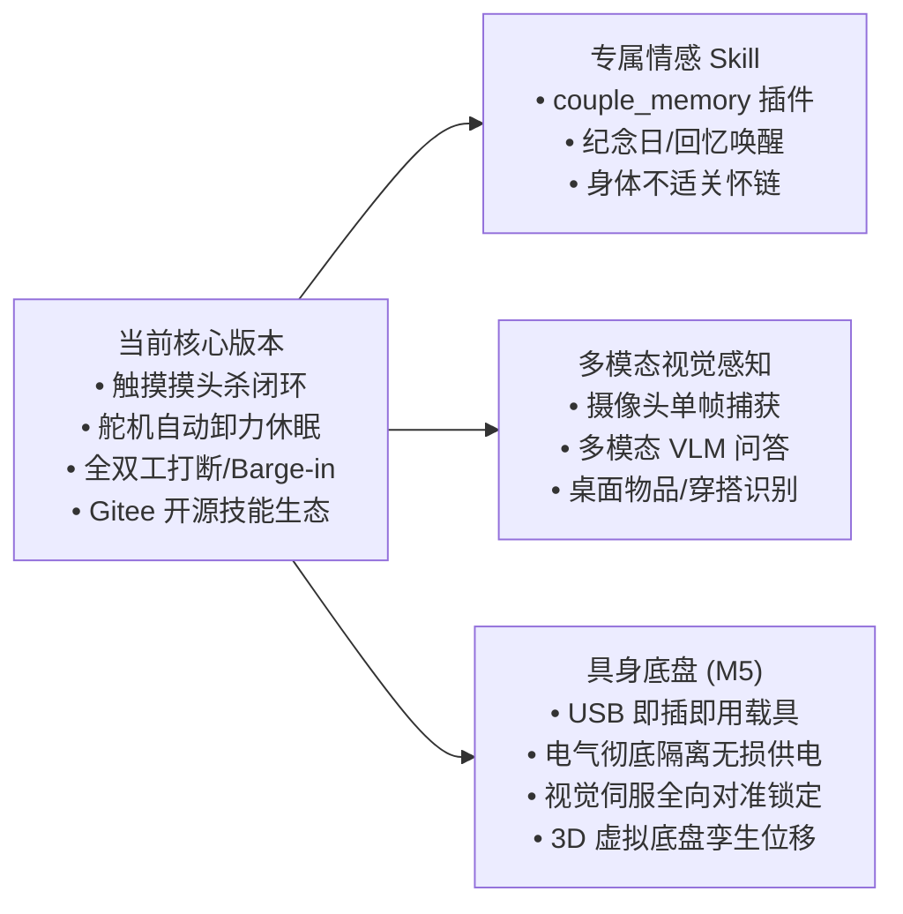
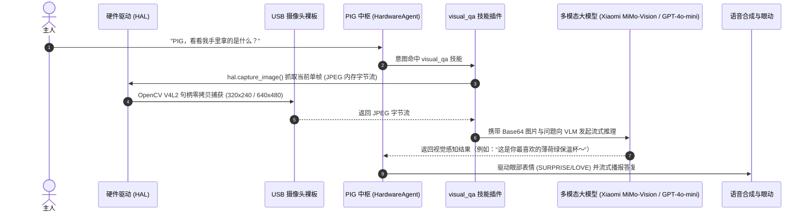
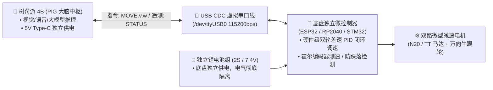

# 🚀 PIG 桌面 AI 机器人 - 后续迭代技术规划 (ROADMAP)

> **版本**：v2.1.0 Roadmap  
> **适用平台**：树莓派 3B / 3B+ / 4B + Web 3D 数字孪生仿真平台  
> **更新时间**：2026-11-23

---

## 目录
- [一、 迭代总览与演进路线](#一-迭代总览与演进路线)
- [二、 P2：多模态视觉认知与场景问答 (Visual QA)](#二-p2多模态视觉认知与场景问答-visual-qa)
- [三、 P1：专属情感陪伴技能生态 (Couple Memory Skill)](#三-p1专属情感陪伴技能生态-couple-memory-skill)
- [四、 硬件拓展：三键实体导航与 OSD 交互菜单](#四-硬件拓展三键实体导航与-osd-交互菜单)
- [五、 具身移动进化：USB 模块化动力底盘 (Mobile Embodied Chassis)](#五-具身移动进化usb-模块化动力底盘-mobile-embodied-chassis)
- [六、 交付物与阶段规划](#六-交付物与阶段规划)

---

## 一、 迭代总览与演进路线



---

## 二、 P2：多模态视觉认知与场景问答 (Visual QA)

### 1. 定位与范围界定
- **核心定位**：打破“只能听和说”的局限，让机器人拥有看懂眼前环境的能力。当主人手持物品、展示穿搭、阅读包装说明书时，PIG 可以通过摄像头看懂并语音解答。
- **范围原则（严守轻量与隐私友好）**：
  - ✅ **支持**：物品识别、文字/标签 OCR、穿着与穿搭建议、绿植状态辨析、手势与桌面场景问答。
  - ❌ **不引入人脸特征比对与生物识别**：无需引入人脸特征库、身份验证与数据库比对，杜绝人脸识别模型引起的 CPU 内存暴涨（树莓派 3B 仅 1GB RAM），确保极简且无隐私泄露风险。

### 2. 软件链路与技术实现


### 3. 拟引入技能：`skills/visual_qa/`
- **契约规范**：
  - `skill.json`: 声明为多模态视觉技能，定义参数 `question`（如 "手里是什么", "我好看吗", "阅读文字"）。
  - `main.py`: 调用 `RobotHAL.capture_image()`，调用多模态大模型接口，返回自然口语化的 Observation。
- **树莓派 3B 优化措施**：
  - 抓拍采用单帧按需抓取，不启动持续的后台视频流解析；
  - 图像压缩至 480P 以下，网络传输耗时 < 150ms。

---

## 三、 P1：专属情感陪伴技能生态 (Couple Memory Skill)

### 1. 架构契约与纯净性原则
依据《核心架构设计与开发准则》（`docs/ARCHITECTURE_GUIDELINES.md`），内核层严禁硬编码特定情感业务。
将 P1 封装为独立的顶级技能插件：`skills/couple_memory/`。

### 2. 功能特性矩阵
1. **专属纪念日引擎 (`anniversaries.json`)**：
   - 记录相识、生日、第一次旅行等专属节点；
   - 结合 `circadian` 生物钟，在重要日子的清晨首轮对话中主动触发专属彩蛋。
2. **身体不适与健康关怀流 (`health_tracker`)**：
   - 当主人对话中提及“胃疼”、“感冒”、“肚子不舒服”时，自动打上关怀标签并在后续 1~3 天主动跟进询问。
3. **PIG 专属问答知识库 (`love_stories.json`)**：
   - 记录两人的故事与回忆，大模型在闲聊时能随时调取真实记忆，充满专属定制感。

---

## 四、 硬件拓展：三键实体导航与 OSD 交互菜单

### 1. 硬件引脚分配 (40-Pin Header)
利用树莓派内部弱上拉电阻（`PUD_UP`），无需外接上拉电阻与电容：
- **上键 (UP)**：GPIO 23 (Pin 16)
- **下键 (DOWN)**：GPIO 24 (Pin 18)
- **确认键 (ENTER/CONFIRM)**：GPIO 27 (Pin 13)
- **公共地 (GND)**：Pin 14 / Pin 20

### 2. 交互理念：防工控化，守护“生命感”
- **常态**：屏幕 100% 显示灵动动态眼球与注视追踪；
- **唤醒**：短按任意实体按键，屏幕底部滑出半透明悬浮气泡菜单（OSD Mini Dock）；
- **超时**：5 秒无按键操作，平滑淡出，无缝退回眼球生命体征；
- **打断**：若在操作菜单时主人发出语音唤醒，菜单立即秒退，优先响应语音。

### 3. 核心功能页面规划
1. **页面一：系统仪表盘 (Status HUD)**：查看当前局域网 IP、WiFi 信号、CPU 温度。
2. **页面二：快速工具箱 (Quick Tools)**：一键静音、音量调节、伴睡/专注模式切换。
3. **页面三：一键配网 (Network Setup)**：热点 AP 开关、屏幕显示 WiFi 配网二维码。
4. **页面四：电源管理 (Power)**：服务重启、长按 3 秒安全关机（防拔电坏 SD 卡）。

---

## 五、 具身移动进化：USB 模块化动力底盘 (Mobile Embodied Chassis)

### 1. 核心定位：“机甲合体 / 扩展坞”式即插即用载具
- **常态（桌面伴宠模式）**：静置桌面，以 2-DOF 脖子转头、表情屏、语音多模态交流为主，极低待机功耗。
- **扩展（移动伴侣模式）**：将 PIG 置于轮式底盘上，通过**一根标准 Type-C USB 数据线**相连，机器人瞬间解锁“双腿”，变身为可在地面/桌面巡航的具身移动机器人（类似 Vector / Emo）。

### 2. 硬件拓扑与电气隔离设计


- **电气彻底隔离**：底盘由独立锂电池组供电，电机启停的大电流与感性反电动势完全被底盘硬件隔离吸收，**树莓派只通过 USB 走纯数字逻辑信号，彻底杜绝拉垮系统电压或烧毁 GPIO 的风险**。
- **即插即用热插拔**：拔掉 USB 线即退回桌面摆件，插上 USB 线秒级自动握手激活底盘驱动。

### 3. 软件 HAL 层契约与优雅降级
```python
class BaseChassis(ABC):
    """底盘运动硬件抽象接口"""
    @abstractmethod
    def move(self, linear: float, angular: float, duration: float = 0.0):
        """
        :param linear: 前后线速度 [-1.0, 1.0] (正为前，负为后)
        :param angular: 原地旋转角速度 [-1.0, 1.0] (正为顺时针/右转，负为逆时针/左转)
        :param duration: 持续时间 (秒)，0 为非阻塞
        """
        pass

    @abstractmethod
    def stop(self):
        """紧急制动刹车"""
        pass
```
- **双模驱动自适应**：
  - `NoopChassis`：未连接 USB 底盘时默认加载，接收移动指令不报错，可触发虚拟开动拟声。
  - `USBSerialChassis`：探测到 `/dev/ttyUSB*` 设备并握手成功时动态加载，自动向单片机推送串口帧。
- **3D 数字孪生同步**：Web 仿真工作台中的虚拟 3D PIG 底座同步支持位移渲染，可通过键盘 `WASD` 实时遥控。

### 4. 具身 AI 进阶玩法
1. **视觉伺服全向对准 (Visual Servoing)**：当人脸注视追踪超出头部舵机机械极限（<40° 或 >140°）时，底盘联动原地自转，将目标重新拉入视野正中心，实现 360° 无死角视线锁定。
2. **大模型自然语言导航**：“小猪往前走两步”、“转过来看看我”、“去门口巡逻一下”。
3. **情绪肢体语言增强**：开心兴奋时 360° 原地转圈欢呼；受惊或被批评时后退两步拉开距离低头；困倦时倒退回充电坞。

---

## 六、 交付物与阶段规划

| 里程碑 | 目标 | 核心输出 |
| :--- | :--- | :--- |
| **M1 (已完成)** | P0 硬件落地与闭环 | 摸头传感器中断 + 舵机防抖卸力 + 全双工打断 (Barge-in) + Web 孪生按钮 |
| **M2 (已完成)** | 飞书与多Session助理 | 飞书双向 Bot 接入 + Session 隔离多端会话 + 报警推送通道 |
| **M3 (已完成)** | Gitee 在线开源技能生态 | 纯在线开源 Registry (`registry/`) + 14款精选技能一键安装热加载 |
| **M4 (已完成)** | 硬件自检与 OSD 菜单 | 4按键 FSM 菜单 + ST7789 2.4寸屏幕 OSD 状态与 AP 热点配网 |
| **M5 (规划中)** | USB 模块化动力底盘 | USB 即插即用动力底盘驱动 (`drivers/chassis_usb.py`) + `BaseChassis` 抽象层 + 视觉伺服联动 + 3D 虚拟底盘控制 |
