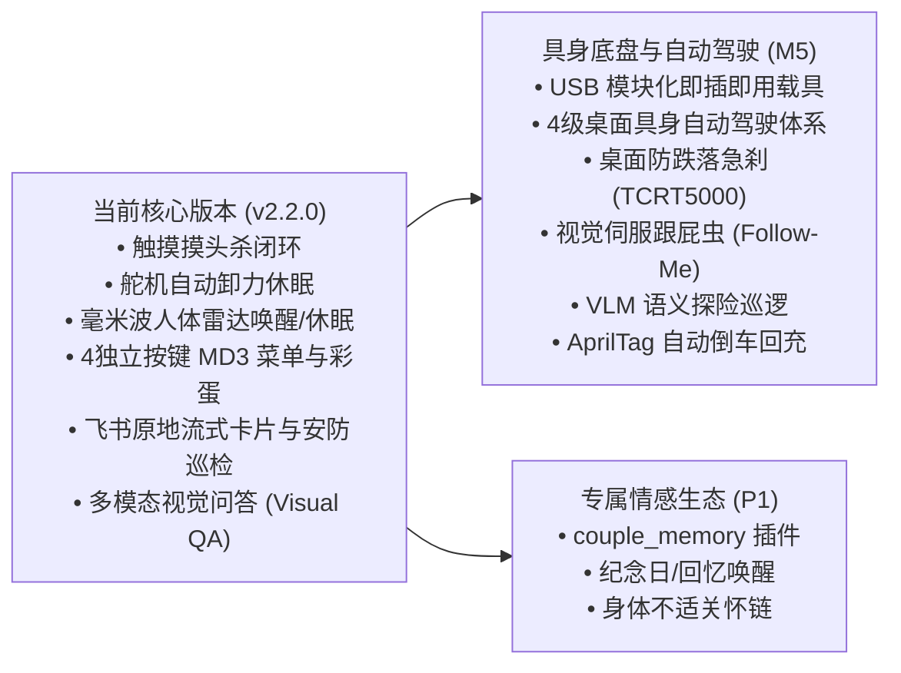
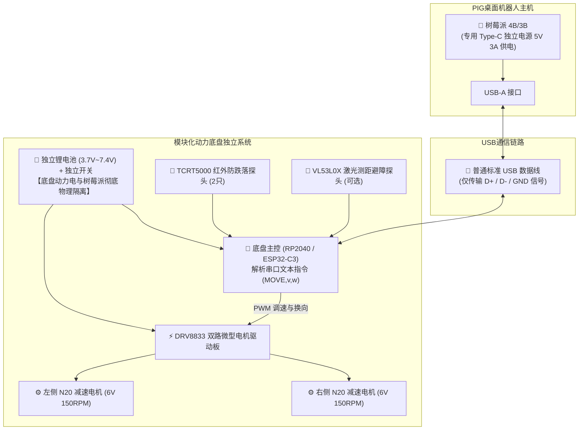
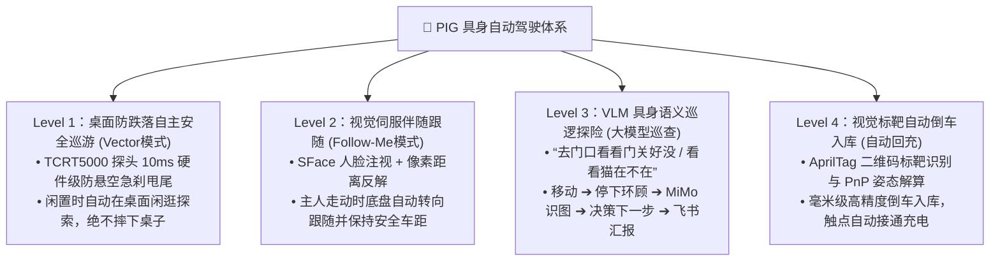

# 🚀 PIG 桌面 AI 机器人 - 后续迭代技术规划 (ROADMAP)

> **版本**：v2.2.0 Roadmap  
> **适用平台**：树莓派 3B / 3B+ / 4B + Web 3D 数字孪生仿真平台  
> **更新时间**：2026-11-24

---

## 目录
- [一、 迭代总览与演进路线](#一-迭代总览与演进路线)
- [二、 多模态视觉认知与场景问答 (Visual QA - 已就绪)](#二-多模态视觉认知与场景问答-visual-qa---已就绪)
- [三、 实体导航与 OSD 交互菜单系统 (Menu FSM - 已就绪)](#三-实体导航与-osd-交互菜单系统-menu-fsm---已就绪)
- [四、 专属情感陪伴技能生态 (Couple Memory Skill)](#四-专属情感陪伴技能生态-couple-memory-skill)
- [五、 具身移动进化：USB 模块化动力底盘与具身自动驾驶体系 (Chassis & Autonomous Driving)](#五-具身移动进化usb-模块化动力底盘与具身自动驾驶体系-chassis--autonomous-driving)
- [六、 交付物与阶段规划](#六-交付物与阶段规划)

---

## 一、 迭代总览与演进路线



---

## 二、 多模态视觉认知与场景问答 (Visual QA - 已就绪)

### 1. 定位与已落地能力
- **核心定位**：打破“只能听和说”的局限，让机器人拥有看懂眼前环境的能力。当主人手持物品、展示穿搭、阅读包装说明书时，PIG 可以通过摄像头看懂并语音解答。
- **已落地技术链路**：
  - ✅ **多通道画面零拷贝抓取**：Web 仿真端摄像头 ➔ 树莓派真机硬件 HAL ➔ `/dev/video0` 物理免驱 USB 摄像头；
  - ✅ **TTL 时效防穿透拦截**：内置 12 秒严格时效校验，杜绝陈旧旧图误导；
  - ✅ **小米 MiMo-v2.6-Flash 原生多模态大模型**：物品识别、文字/标签 OCR、穿着与穿搭建议、环境场景问答；
  - ✅ **拟人化口语输出**：输出 40~90 字亲切自然的交流口吻，抓拍瞬间自动持久化至 `/tmp/pig_visual_qa_snapshot.jpg`。

---

## 三、 实体导航与 OSD 交互菜单系统 (Menu FSM - 已就绪)

### 1. 硬件引脚分配 (40-Pin Header)
利用树莓派内部弱上拉电阻（`PUD_UP`）与 30ms 硬件消抖：
- **K1 (音量+ / 菜单上移)**：GPIO 23 (Pin 16)
- **K2 (音量- / 菜单下移)**：GPIO 24 (Pin 18)
- **K3 (确认进入 / 切换开关 / 手动唤醒)**：GPIO 27 (Pin 13)
- **K4 (返回退出 / 静音闭麦 / 长按关机)**：GPIO 4 (Pin 7)
- **公共地 (GND)**：Pin 14 / Pin 20

### 2. 已落地特性
- **60 FPS 阻尼连续滚动 (Damped Lerp)**：$\Delta y = (\text{target} - \text{current}) \times 0.22$，平滑收敛，卡片露出预览（Peeking Cards）；
- **4 大一级菜单与 20+ 项功能**：WiFi 状态与二维码配网、系统硬件与延迟体检（Doctor）、9 项硬件开关（含毫米波雷达与舵机卸力）、11 项系统参数设置；
- **关于本项目 (PIG) 极客自述彩蛋**：版本号连续点击 5 次解密展开，纯净正文字重平滑滚动。

---

## 四、 专属情感陪伴技能生态 (Couple Memory Skill)

### 1. 架构契约与纯净性原则
依据《核心架构设计与开发准则》（`docs/ARCHITECTURE_GUIDELINES.md`），内核层严禁硬编码特定情感业务。
将 P1 封装为独立的顶级技能插件：`skills/couple_memory/`。

### 2. 功能特性矩阵
1. **专属纪念日引擎 (`anniversaries.json`)**：
   - 记录相识、生日、第一次旅行等专属节点；
   - 结合 `circadian` 生物钟，在重要日子的清晨首轮对话中主动触发专属彩蛋。
2. **身体不适与健康关怀流 (`health_tracker`)**：
   - 当主人对话中提及“胃疼”、“感冒”、“肚子不舒服”时，自动打上关怀标签并在后续 1~3 天主动跟进询问。
3. **PIG 专属问答知识库 (`love_stories.json`)**：
   - 记录两人的故事与回忆，大模型在闲聊时能随时调取真实记忆，充满专属定制感。

---

## 五、 具身移动进化：USB 模块化动力底盘与具身自动驾驶体系 (Chassis & Autonomous Driving)

### 1. 核心定位：“机甲合体 / 扩展坞”式即插即用载具
- **常态（桌面伴宠模式）**：静置桌面，以 2-DOF 脖子转头、表情屏、语音多模态交流为主，极低待机功耗。
- **扩展（移动伴侣模式）**：将 PIG 置于轮式底盘扩展坞上，通过**一根标准 USB 数据线**与树莓派相连，机器人瞬间解锁“双腿”，变身为可在地面/桌面巡航的具身移动机器人（类似 Vector / Emo）。

### 2. 硬件拓扑与电气隔离铁律


- **电气彻底隔离**：底盘由独立锂电池组供电，电机启停的大电流（瞬间冲击可达 800mA+）与感性反电动势完全被底盘硬件隔离吸收，**树莓派 USB 口仅走纯数字逻辑信号，彻底杜绝拉垮系统电压或烧毁 GPIO 的风险**。
- **即插即用热插拔**：拔掉 USB 线即退回桌面摆件，插上 USB 线秒级自动握手激活底盘驱动。

### 3. 硬件精准选型清单 (高性价比与开箱即用)

* **方案 A：开箱即用微型差速底盘（成品套件，约 40~60 元）**：
  - 选型：ESP32 / RP2040 迷你两轮差速智能小车底盘（集成 N20 电机 + 橡胶轮 + 万向轮 + Type-C USB 串口）。
* **方案 B：模块化 DIY 自主搭配（约 35 元，适合 3D 打印托盘）**：
  1. **主控**：`RP2040-Zero` 或 `ESP32-C3 SuperMini`（拇指大小，板载 Type-C，支持原生 USB CDC 虚拟串口，约 11 元）；
  2. **电机**：`GA12-N20` 微型全金属减速电机 2 只（6V 100~200 RPM，推荐 150 RPM 桌面巡航黄金转速，约 5 元/只）；
  3. **驱动**：`DRV8833` 双路 H 桥微型驱动板（超小发热量，单通道 1.5A 峰值，约 3 元）；
  4. **车轮与导向**：34mm/43mm 橡胶轮胎 2 只 + 10mm 钢珠万向牛眼轮 1 只（约 6 元）；
  5. **防跌落传感器**：`TCRT5000` 红外反射式光电开关 2 只（约 3 元）；
  6. **前向测距探头（可选）**：`VL53L0X` 激光 ToF 飞行时间测距模块（约 8 元，0~2 米毫米级避障）。

---

### 4. 四级具身自动驾驶体系 (4-Level Autonomous Driving)



#### Level 1：桌面防跌落自主安全巡游 (Desktop Edge Cliff Avoidance)
* **悬空保护机制**：底盘前端两侧向下安装 TCRT5000 红外反射传感器，以 50Hz 持续探测桌面反射率：
  - 正常在桌面行驶时，红外光被桌面反射，OUT 输出低电平；
  - 一旦开到桌子边缘，光线射空无反射，**底盘 MCU 在 10ms 内触发最高优先级硬件中断急刹，强制倒退 3cm 并原地转向 60° 避开边缘**；
* **生命律动巡游**：机器人无聊（BORED/IDLE）时，自发在桌面上慢慢探索漫步、转头四顾，充满生命质感。

#### Level 2：视觉伺服伴随跟随模式 (Visual Follow-Me)
* **角度伺服**：结合 OpenCV 人脸检测坐标，当主人在工位左右走动超出脖子物理极限（Pan < 40° 或 > 140°）时，底盘联动原地差速自转，实现 **360° 无死角视线锁定**；
* **距离伺服**：通过人脸在摄像头视野中的人脸框像素占比（Bounding Box Ratio）估算物理距离：
  - 主人后退走远时，底盘以平滑加速度向前开进跟随；
  - 主人靠近时，底盘减速停驻在 40~60cm 黄金舒适距离，抬头微笑迎候。

#### Level 3：VLM 多模态大模型具身巡逻探险 (Embodied VLM Exploration & Patrol)
* **闭环交互**：结合飞书 Bot 或语音指令：“小猪，在屋里转一圈，看看猫猫在哪里？”
* **ReAct 具身行动链路**：
  1. `chassis_control.move(linear=0.4, duration=2.0)` ➔ 向前巡航一段距离；
  2. 脖子云台左右转动（Pan 45° ➔ 90° ➔ 135°）并调用 `hal.capture_image()`；
  3. 调用 MiMo-v2.6-Flash 多模态视觉大模型：“当前视野为走廊，未发现猫，需要向右侧转弯”；
  4. 底盘执行右转并继续探索，直至画面中检测到猫咪；
  5. 飞书端原地刷新流式卡片，推送现场高清快照与诊断汇报：“主人，发现猫猫正在猫窝里睡觉呢～”。

#### Level 4：AprilTag 视觉标靶自动倒车入库回充 (Autonomous Docking & Charging)
* **硬件设计**：在充电桩侧贴附 2cm 微型 AprilTag 标靶二维码，底盘尾部露出自锁弹性充电铜触点；
* **姿态解算**：摄像头捕获 AprilTag 4 个角点像素，调用 OpenCV `solvePnP` 解算出小车相对充电坞的 3D 相对位姿 $(x, y, \theta)$；
* **闭环泊车**：执行两段式倒车轨迹控制（粗对准转向 ➔ 倒车入库精确微调），完成自主回充。

---

### 5. 软件 HAL 层契约与极简串口协议

```python
class BaseChassis(ABC):
    """底盘运动硬件抽象接口"""
    @abstractmethod
    def move(self, linear: float, angular: float, duration: float = 0.0):
        """
        :param linear: 前后线速度 [-1.0, 1.0] (正为前，负为后)
        :param angular: 原地旋转角速度 [-1.0, 1.0] (正为顺时针/右转，负为逆时针/左转)
        :param duration: 持续时间 (秒)，0 为非阻塞
        """
        pass

    @abstractmethod
    def stop(self):
        """紧急制动刹车"""
        pass
```

* **双模自动降级**：
  - `NoopChassis`：未插物理底盘时默认加载，接收移动指令不报错，广播虚拟位移并播放轻快马达开动音效；
  - `USBSerialChassis`：检测到 `/dev/ttyUSB*` 或 `/dev/ttyACM*` 插入时秒级自动握手热加载。
* **极简串口协议 (115200 bps)**：
  - 树莓派下发：`MOVE,100,0\n`（前进）、`MOVE,-100,0\n`（后退）、`MOVE,0,80\n`（原地右转）、`STOP\n`（急刹）；
  - 底盘上报：`STATUS,battery_mv,cliff_left,cliff_right\n`；
  - **500ms 看门狗保护**：底盘超过 500ms 未收到有效串口心跳帧，自动强制刹车，彻底防止上位机卡死时小车失控。
* **3D 数字孪生同步**：Web 仿真工作台中的 3D PIG 模型装配轮式底座，支持键盘 **`W / A / S / D`** 实时遥控位移，数字孪生实时投影。

---

## 六、 交付物与阶段规划

| 里程碑 | 目标 | 核心输出 | 状态 |
| :--- | :--- | :--- | :--- |
| **M1** | P0 硬件落地与闭环 | 摸头传感器中断 + 舵机防抖卸力 + 全双工打断 (Barge-in) + Web 孪生按钮 | ✅ 已完成 |
| **M2** | 飞书与多Session助理 | 飞书双向 Bot 接入 + 原地流式卡片更新 + 安防巡检与旧图拦截 | ✅ 已完成 |
| **M3** | Gitee 在线开源技能生态 | 纯在线开源 Registry (`registry/`) + 14款精选技能一键安装热加载 | ✅ 已完成 |
| **M4** | 硬件自检与 OSD 菜单 | 4按键 FSM 菜单 + ST7789 2.4寸屏幕 OSD 状态与 AP 热点配网 + 极客自述彩蛋 | ✅ 已完成 |
| **M5** | 具身底盘与自动驾驶 | USB 即插即用动力底盘驱动 (`drivers/chassis_usb.py`) + 4级自动驾驶体系 (桌面防跌落/视觉跟屁虫/大模型巡逻/AprilTag回充) + 3D 仿真 WASD 遥控 | 🚀 下阶段核心 |
| **P1** | 专属情感陪伴技能生态 | couple_memory 插件 + 专属纪念日唤醒 + 身体不适跨天关怀链 | 规划中 |
