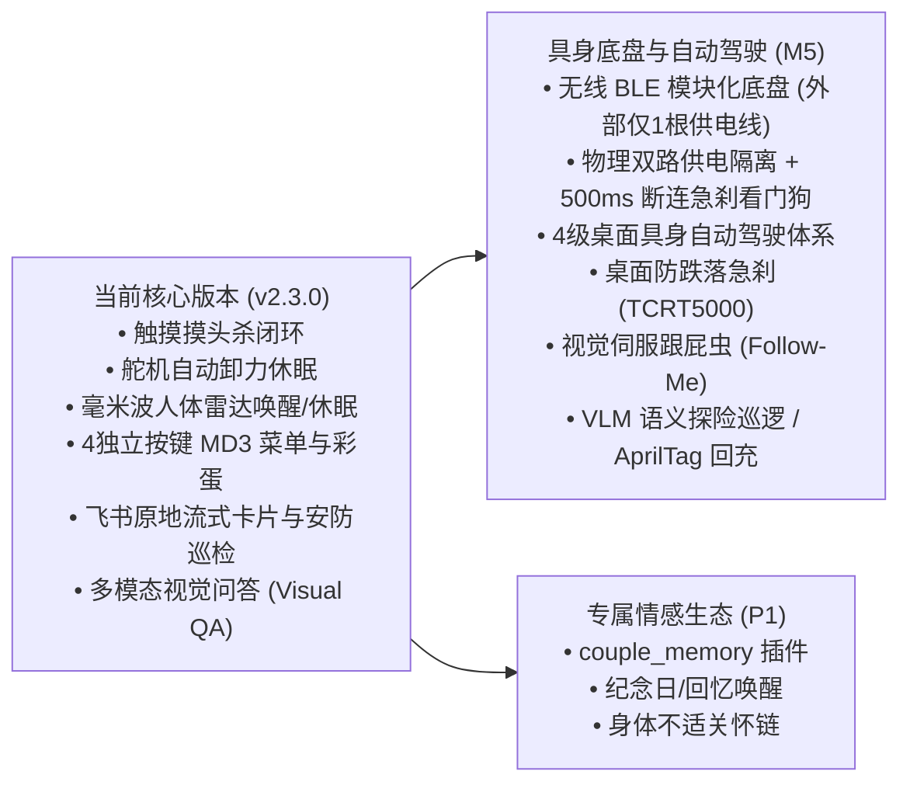
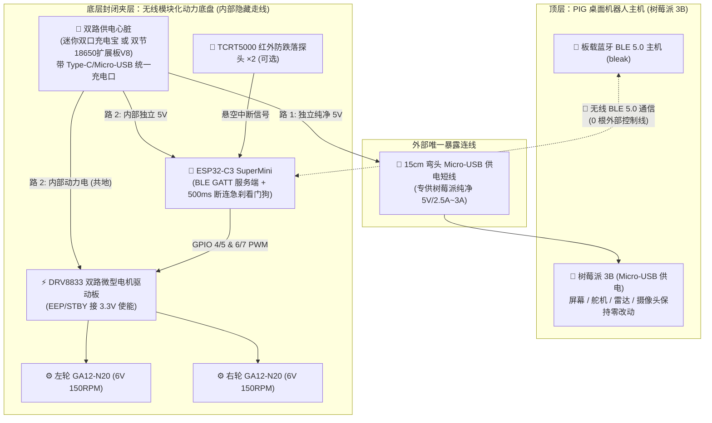
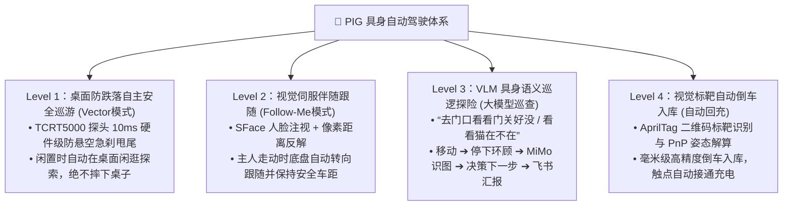

# 🚀 PIG 桌面 AI 机器人 - 后续迭代技术规划 (ROADMAP)

> **版本**：v2.3.0 Roadmap  
> **适用平台**：树莓派 3B / 3B+ / 4B + Web 3D 数字孪生仿真平台  
> **更新时间**：2026-11-25

---

## 目录
- [一、 迭代总览与演进路线](#一-迭代总览与演进路线)
- [二、 多模态视觉认知与场景问答 (Visual QA - 已就绪)](#二-多模态视觉认知与场景问答-visual-qa---已就绪)
- [三、 实体导航与 OSD 交互菜单系统 (Menu FSM - 已就绪)](#三-实体导航与-osd-交互菜单系统-menu-fsm---已就绪)
- [四、 专属情感陪伴技能生态 (Couple Memory Skill)](#四-专属情感陪伴技能生态-couple-memory-skill)
- [五、 具身移动进化：无线 BLE 模块化动力底盘与自动驾驶 (Chassis & Autonomous Driving)](#五-具身移动进化无线-ble-模块化动力底盘与自动驾驶-chassis--autonomous-driving)
- [六、 交付物与阶段规划](#六-交付物与阶段规划)

---

## 一、 迭代总览与演进路线



---

## 二、 多模态视觉认知与场景问答 (Visual QA - 已就绪)

### 1. 定位与已落地能力
- **核心定位**：打破“只能听和说”的局限，让机器人拥有看懂眼前环境的能力。当主人手持物品、展示穿搭、阅读包装说明书时，PIG 可以通过摄像头看懂并语音解答。
- **已落地技术链路**：
  - ✅ **多通道画面零拷贝抓取**：Web 仿真端摄像头 ➔ 树莓派真机硬件 HAL ➔ `/dev/video0` 物理免驱 USB 摄像头；
  - ✅ **TTL 时效防穿透拦截**：内置 12 秒严格时效校验，杜绝陈旧旧图误导；
  - ✅ **小米 MiMo-v2.6-Flash 原生多模态大模型**：物品识别、文字/标签 OCR、穿着与穿搭建议、环境场景问答；
  - ✅ **拟人化口语输出**：输出 40~90 字亲切自然的交流口吻，抓拍瞬间自动持久化至 `/tmp/pig_visual_qa_snapshot.jpg`。

---

## 三、 实体导航与 OSD 交互菜单系统 (Menu FSM - 已就绪)

### 1. 硬件引脚分配 (40-Pin Header)
利用树莓派内部弱上拉电阻（`PUD_UP`）与 30ms 硬件消抖：
- **K1 (音量+ / 菜单上移)**：GPIO 23 (Pin 16)
- **K2 (音量- / 菜单下移)**：GPIO 24 (Pin 18)
- **K3 (确认进入 / 切换开关 / 手动唤醒)**：GPIO 27 (Pin 13)
- **K4 (返回退出 / 静音闭麦 / 长按关机)**：GPIO 4 (Pin 7)
- **公共地 (GND)**：Pin 14 / Pin 20

### 2. 已落地特性
- **60 FPS 阻尼连续滚动 (Damped Lerp)**：$\Delta y = (\text{target} - \text{current}) \times 0.22$，平滑收敛，卡片露出预览（Peeking Cards）；
- **4 大一级菜单与 20+ 项功能**：WiFi 状态与二维码配网、系统硬件与延迟体检（Doctor）、9 项硬件开关（含毫米波雷达与舵机卸力）、11 项系统参数设置；
- **关于本项目 (PIG) 极客自述彩蛋**：版本号连续点击 5 次解密展开，纯净正文字重平滑滚动。

---

## 四、 专属情感陪伴技能生态 (Couple Memory Skill)

### 1. 架构契约与纯净性原则
依据《核心架构设计与开发准则》（`docs/ARCHITECTURE_GUIDELINES.md`），内核层严禁硬编码特定情感业务。
将 P1 封装为独立的顶级技能插件：`skills/couple_memory/`。

### 2. 功能特性矩阵
1. **专属纪念日引擎 (`anniversaries.json`)**：
   - 记录相识、生日、第一次旅行等专属节点；
   - 结合 `circadian` 生物钟，在重要日子的清晨首轮对话中主动触发专属彩蛋。
2. **身体不适与健康关怀流 (`health_tracker`)**：
   - 当主人对话中提及“胃疼”、“感冒”、“肚子不舒服”时，自动打上关怀标签并在后续 1~3 天主动跟进询问。
3. **PIG 专属问答知识库 (`love_stories.json`)**：
   - 记录两人的故事与回忆，大模型在闲聊时能随时调取真实记忆，充满专属定制感。

---

## 五、 具身移动进化：无线 BLE 模块化动力底盘与自动驾驶 (Chassis & Autonomous Driving)

### 1. 核心定位与架构决策（告别“盘丝洞”的极简一线流）
针对树莓派 3B/3B+（Micro-USB 仅支持供电、40-Pin GPIO 已大量占用屏幕/按键/舵机/雷达）的物理现状，确立 **“内部无线化、外部仅 1 根供电短线、动力与控制电物理双路隔离”** 的终极干净结构：

* **外部极简走线（仅 1 根线）**：底盘与树莓派之间**没有通信飞线**，仅从底盘内部电源口引出 **1 根 15cm 弯头 Micro-USB 短线** 向上插入树莓派 3B 供电口。
* **零引脚冲突（无线 BLE 控制）**：树莓派通过板载蓝牙（BLE 5.0）向底盘内的 `ESP32-C3` 下发运动指令。
  - **为什么选 BLE 蓝牙而非 Wi-Fi？** 不抢占树莓派的 Wi-Fi 网卡（确保树莓派随时保持外网连接调 MiMo 大模型与飞书），脱离路由器出门照常控车，延迟约 15~30ms，完全满足桌面巡航与视觉跟随需求；
  - **零 GPIO 占用**：树莓派现有 ST7789 SPI 屏幕、SG90 舵机、4 独立按键与 LD2402 毫米波雷达**一根线不用挪、零引脚冲突**。
* **两层夹心汉堡包结构**：电池、ESP32-C3、DRV8833 驱动板及杜邦线全部隐藏封装在底盘夹层肚子里，4 根铜柱架起二层亚克力板安放树莓派与 PIG 头部。

### 2. 硬件拓扑与电气隔离铁律


* **彻底防止欠压重启**：充电宝双口输出（或 V8 扩展板电源分路）将树莓派供电与电机动力电在前端隔离，哪怕马达启停或遇到阻力，也**绝对不会拉垮树莓派 5V 电压导致死机/损坏 SD 卡**。
* **500ms 看门狗保命机制（必须实现）**：无线控车一旦蓝牙闪断或上位机重启，若不制动小车会冲下桌子。因此 `ESP32-C3` 固件内置死命令——**连续 500ms 未收到树莓派 BLE 心跳/控制帧，立即强制全轮刹车归零**。

---

### 3. 轮式机械选型决策：为什么首选【2驱 + 万向轮】而非 4 驱？

| 对比维度 | **2驱差速 + 万向轮 / 双万向支撑（强烈推荐）** | **4驱短轴底盘（可选）** |
| :--- | :--- | :--- |
| **桌面平面稳定性** | ✅ **三点确定一个平面**，永远 100% 贴地；若将主轮居中、前后各放一个小万向牛眼轮，4 个方向都有支撑，绝不前倾翻倒 | ⚠️ 刚性四轮遇微不平桌面易有 1 个轮子悬空打滑 |
| **转弯表现与摩擦力** | ✅ **0 横向搓磨阻力**，在鼠标垫/桌布上照样 360° 丝滑原地转圈，N20 小马达轻松带得动 | ❌ 无前轮转向舵机，转弯需四轮生生横着打滑搓地板，在防滑桌垫上极易卡顿憋停 |
| **自动驾驶角度精度** | ✅ 转弯角度线性精准，完美适配 Level 2 视觉跟屁虫与 Level 4 AprilTag 倒车入库 | ❌ 滑移转向受地面摩擦影响大，转弯角度误差大 |
| **功耗与接线复杂度** | ✅ 仅 2 颗电机（巡航共 ~150~200mA），单块 DRV8833 轻松直推 | ⚠️ 功耗翻倍；需将同侧前后 2 个电机并联进 DRV8833 同侧通道，且选“方正短轴距”底盘 |

---

### 4. 淘宝直接采购硬件 BOM 清单（全套约 75~85 元，几乎免焊接）

> 💡 **免焊接采购核心技巧**：下单时让店家选**“焊好排针”**版模块、**“电机已焊导线/带插头”**版马达，到货后全部靠母对母杜邦线对插即可完成组装！

| 序号 | 模块角色 | 淘宝搜索关键词 | 选型规格与避坑注意 | 数量 | 预估单价 |
| :---: | :--- | :--- | :--- | :---: | :---: |
| **1** | **机械底盘与轮子** | `N20 差速两驱小车底盘 亚克力` | 含 2 个 **GA12-N20 电机（选 `6V 150RPM` 或 `100RPM`）** + 橡胶轮 ×2 + 万向牛眼轮 ×1（或配双万向轮 + 4根铜柱支架）。务必勾选**“电机带焊好导线”** | 1 套 | ~25~30 元 |
| **2** | **底盘无线大脑** | `ESP32-C3 SuperMini` | 拇指盖大小，自带 BLE 5.0 + Wi-Fi + Type-C 下载口。务必拍**“焊好排针”**版 | 1 块 | ~11 元 |
| **3** | **电机驱动芯片** | `DRV8833 电机驱动模块` | 支持 2.7V~10.8V 宽压、超低发热、自带过流保护。务必拍**“焊好排针”**版 | 1 块 | ~4 元 |
| **4** | **电源心脏（A/B二选一）** | **方案 A（最省心安全）**：`迷你双口输出充电宝 5000mAh 扁平` + `USB公头转杜邦母头 5V供电线`<br>**方案 B（18650一体板）**：`18650 电池扩展板 V8 双节 5V 3A` + 2节18650电池 | **A 方案**：自带保护芯片与电量显示，口1喂树莓派，口2用USB转杜邦线在内部喂底盘；因树莓派常驻耗电，充电宝永不自动休眠。<br>**B 方案**：V8扩展板自带电池座、开关、Type-C充电口、USB-A输出及现成5V/GND排针 | 1 套 | ~30~38 元 |
| **5** | **唯一外部供电短线** | `15cm 弯头 Micro-USB 充电短线 3A` | 务必买加粗支持 **2.4A~3A 大电流**短线（劣质细线压降大易导致树莓派欠压图标） | 1 根 | ~5 元 |
| **6** | **内部对插线材** | `母对母杜邦线 10cm` | 用于连接底盘内部电源、ESP32-C3 与 DRV8833（10cm 越短越整洁） | 1 排 | ~3 元 |
| **7** | **防跌落探头（可选）** | `TCRT5000 红外反射光电模块` | 装在车头底部朝下离桌 1~2cm，用于 Level 1 桌沿防跌落 10ms 急刹 | 2 只 | ~3 元 |

#### 底盘内部 5 分钟接线引脚对照表（全封装于夹层内部）
1. **内部供电与共地**：
   - 电源口 1（USB-A 大口） ──（**唯一外部短线**）──► 树莓派 3B `Micro-USB` 电源口
   - 电源口 2（内部 `5V` 正极） ──► `ESP32-C3` 的 **`5V`** 脚 & `DRV8833` 的 **`VCC`** 脚
   - 电源口 2（内部 `GND` 负极） ──► `ESP32-C3` 的 **`GND`** 脚 & `DRV8833` 的 **`GND`** 脚
2. **控制信号线（ESP32-C3 ➔ DRV8833，共 5 根内部杜邦线）**：
   - `ESP32-C3 GPIO 4` ──► `DRV8833 IN1`（左轮 PWM A）
   - `ESP32-C3 GPIO 5` ──► `DRV8833 IN2`（左轮 PWM B）
   - `ESP32-C3 GPIO 6` ──► `DRV8833 IN3`（右轮 PWM A）
   - `ESP32-C3 GPIO 7` ──► `DRV8833 IN4`（右轮 PWM B）
   - ⚠️ **关键使能脚**：`ESP32-C3 3.3V` ──► `DRV8833 EEP`（或 `STBY`/`SLP`，拉高电平唤醒芯片，否则电机默认休眠不转）
3. **马达连线**：
   - `DRV8833 OUT1 / OUT2` ──► 左轮 N20 电机
   - `DRV8833 OUT3 / OUT4` ──► 右轮 N20 电机
4. **防跌落探头（可选）**：
   - 左/右 `TCRT5000` 的 `DO` 引脚 ──► `ESP32-C3 GPIO 2`、`GPIO 3`（供电接 `3.3V / GND`）

---

### 5. 四级具身自动驾驶体系 (4-Level Autonomous Driving)



#### Level 1：桌面防跌落自主安全巡游 (Desktop Edge Cliff Avoidance)
* **悬空保护机制**：底盘前端两侧向下安装 TCRT5000 红外反射传感器，以 50Hz 持续探测桌面反射率：
  - 正常在桌面行驶时，红外光被桌面反射，OUT 输出低电平；
  - 一旦开到桌子边缘，光线射空无反射，**底盘 MCU 在 10ms 内触发最高优先级硬件中断急刹，强制倒退 3cm 并原地转向 60° 避开边缘**；
* **生命律动巡游**：机器人无聊（BORED/IDLE）时，自发在桌面上慢慢探索漫步、转头四顾，充满生命质感。

#### Level 2：视觉伺服伴随跟随模式 (Visual Follow-Me)
* **角度伺服**：结合 OpenCV 人脸检测坐标，当主人在工位左右走动超出脖子物理极限（Pan < 40° 或 > 140°）时，底盘联动原地差速自转，实现 **360° 无死角视线锁定**；
* **距离伺服**：通过人脸在摄像头视野中的人脸框像素占比（Bounding Box Ratio）估算物理距离：
  - 主人后退走远时，底盘以平滑加速度向前开进跟随；
  - 主人靠近时，底盘减速停驻在 40~60cm 黄金舒适距离，抬头微笑迎候。

#### Level 3：VLM 多模态大模型具身巡逻探险 (Embodied VLM Exploration & Patrol)
* **闭环交互**：结合飞书 Bot 或语音指令：“小猪，在屋里转一圈，看看猫猫在哪里？”
* **ReAct 具身行动链路**：
  1. `chassis_control.move(linear=0.4, duration=2.0)` ➔ 向前巡航一段距离；
  2. 脖子云台左右转动（Pan 45° ➔ 90° ➔ 135°）并调用 `hal.capture_image()`；
  3. 调用 MiMo-v2.6-Flash 多模态视觉大模型：“当前视野为走廊，未发现猫，需要向右侧转弯”；
  4. 底盘执行右转并继续探索，直至画面中检测到猫咪；
  5. 飞书端原地刷新流式卡片，推送现场高清快照与诊断汇报：“主人，发现猫猫正在猫窝里睡觉呢～”。

#### Level 4：AprilTag 视觉标靶自动倒车入库回充 (Autonomous Docking & Charging)
* **硬件设计**：在充电桩侧贴附 2cm 微型 AprilTag 标靶二维码，底盘尾部露出自锁弹性充电铜触点；
* **姿态解算**：摄像头捕获 AprilTag 4 个角点像素，调用 OpenCV `solvePnP` 解算出小车相对充电坞的 3D 相对位姿 $(x, y, \theta)$；
* **闭环泊车**：执行两段式倒车轨迹控制（粗对准转向 ➔ 倒车入库精确微调），完成自主回充。

---

### 6. 软件 HAL 层契约与双模通信协议 (BLE 优先 + USB 兼容)

```python
class BaseChassis(ABC):
    """底盘运动硬件抽象接口"""
    @abstractmethod
    def move(self, linear: float, angular: float, duration: float = 0.0):
        """
        :param linear: 前后线速度 [-1.0, 1.0] (正为前，负为后)
        :param angular: 原地旋转角速度 [-1.0, 1.0] (正为顺时针/右转，负为逆时针/左转)
        :param duration: 持续时间 (秒)，0 为非阻塞
        """
        pass

    @abstractmethod
    def stop(self):
        """紧急制动刹车"""
        pass
```

* **三态驱动实现 (`drivers/chassis_ble.py` / `chassis_usb.py`)**：
  - `NoopChassis`：未连接物理底盘时默认加载，接收移动指令不报错，广播虚拟位移并播放轻快马达开动音效；
  - `BLEChassis`（**主力模式**）：基于 Python `bleak` 自动扫描并连接名为 `PIG_CHASSIS` 的 ESP32-C3 BLE GATT Nordic UART 服务，维持 200ms 心跳保活，零外部通信线；
  - `USBSerialChassis`（**调试/备用模式**）：检测到 `/dev/ttyUSB*` 或 `/dev/ttyACM*` 插入时自动串口握手加载。
* **极简统一文本指令协议（BLE UART 与串口共用）**：
  - 树莓派下发：`MOVE,100,0\n`（前进）、`MOVE,-100,0\n`（后退）、`MOVE,0,80\n`（原地右转）、`STOP\n`（急刹）；
  - 底盘上报：`STATUS,battery_mv,cliff_left,cliff_right\n`；
  - **500ms 看门狗保护**：底盘超过 500ms 未收到有效心跳或移动指令帧，自动强制刹车归零。
* **3D 数字孪生同步**：Web 仿真工作台中的 3D PIG 模型装配轮式底座，支持键盘 **`W / A / S / D`** 实时遥控位移，数字孪生实时投影。

---

## 六、 交付物与阶段规划

| 里程碑 | 目标 | 核心输出 | 状态 |
| :--- | :--- | :--- | :--- |
| **M1** | P0 硬件落地与闭环 | 摸头传感器中断 + 舵机防抖卸力 + 全双工打断 (Barge-in) + Web 孪生按钮 | ✅ 已完成 |
| **M2** | 飞书与多Session助理 | 飞书双向 Bot 接入 + 原地流式卡片更新 + 安防巡检与旧图拦截 | ✅ 已完成 |
| **M3** | Gitee 在线开源技能生态 | 纯在线开源 Registry (`registry/`) + 14款精选技能一键安装热加载 | ✅ 已完成 |
| **M4** | 硬件自检与 OSD 菜单 | 4按键 FSM 菜单 + ST7789 2.4寸屏幕 OSD 状态与 AP 热点配网 + 极客自述彩蛋 | ✅ 已完成 |
| **M5** | 无线 BLE 具身底盘与自动驾驶 | `ESP32-C3` BLE 固件(500ms看门狗) + `drivers/chassis_ble.py` + 4级自动驾驶体系 + 3D 仿真 WASD 遥控 | 🚀 下阶段核心 |
| **P1** | 专属情感陪伴技能生态 | couple_memory 插件 + 专属纪念日唤醒 + 身体不适跨天关怀链 | 规划中 |
