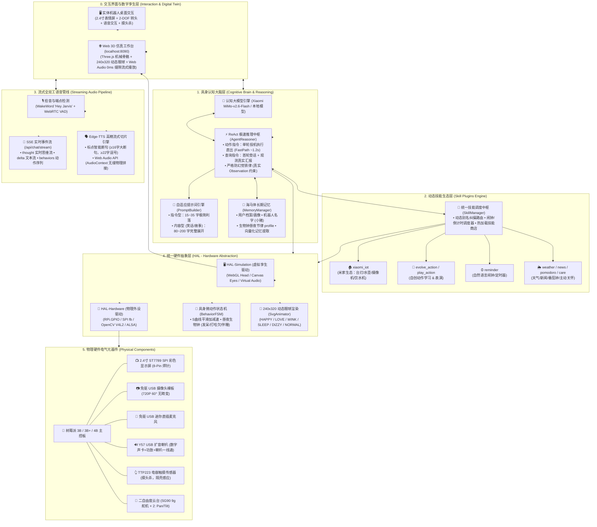
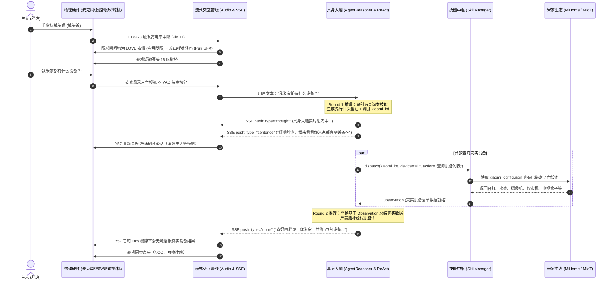

# 🤖 PIG 桌面具身 AI 伴侣 - 全景系统架构与电气连线拓扑

> **版本**：v2.0.0 (Embodied Release)  
> **适用平台**：树莓派 3B / 3B+ / 4B (Raspberry Pi OS 64-bit Lite) + PC WebGL 3D 数字孪生仿真平台  
> **核心宗旨**：软硬件完全解耦、流式低延迟交互、物理隔离供电、技能高内聚热插拔。

---

## 一、 软硬件全景系统架构图 (Full-Stack Architecture)

---

## 二、 树莓派 40-Pin 物理接线与隔离供电拓扑

```mermaid
graph TD
    subgraph Power_System ["⚡ 电源拓扑 (安全单线/隔离方案)"]
        WallPower["🔌 5V 3A / 3.5A 优质电源插头"]
        PiPowerIn["🍓 树莓派 Type-C / Micro-USB 供电口"]
        ServoPowerNode["⚡ 舵机独立电源节点 (Pin 2 / 或外接分线)"]
        Capacitor["🔋 1000μF 16V 滤波大电解电容<br/>(吸收舵机急转瞬间 1A 冲击电流，防欠压重启)"]
        SystemGND["⏚ 统一系统公共地 (Common GND)"]

        WallPower --> PiPowerIn
        PiPowerIn --> ServoPowerNode
        ServoPowerNode --- Capacitor
        Capacitor --- SystemGND
    end

    subgraph RaspberryPi_GPIO ["🍓 树莓派 40-Pin 物理引脚分配 (Pinout)"]
        direction TB
        Pin1["Pin 1: 3.3V PWR"]
        Pin2["Pin 2: 5.0V PWR"]
        Pin6["Pin 6: GND (地)"]
        Pin9["Pin 9: GND (地)"]
        Pin11["Pin 11: GPIO 17"]
        Pin12["Pin 12: GPIO 18 (PWM0)"]
        Pin15["Pin 15: GPIO 22"]
        Pin19["Pin 19: GPIO 10 (MOSI)"]
        Pin22["Pin 22: GPIO 25"]
        Pin23["Pin 23: GPIO 11 (SCLK)"]
        Pin24["Pin 24: GPIO 8 (CE0)"]
        Pin33["Pin 33: GPIO 13 (PWM1)"]
        USB_A["USB 端口 1"]
        USB_B["USB 端口 2"]
        USB_C["USB 端口 3"]
    end

    subgraph Devices ["🔌 连接的外设元器件"]
        Screen_VCC["ST7789 屏幕 VCC"]
        Screen_GND["ST7789 屏幕 GND"]
        Screen_SDA["ST7789 屏幕 SDA/DIN"]
        Screen_SCL["ST7789 屏幕 SCL/CLK"]
        Screen_CS["ST7789 屏幕 CS"]
        Screen_DC["ST7789 屏幕 DC"]
        Screen_RES["ST7789 屏幕 RES"]
        Screen_BLK["ST7789 屏幕 BLK (悬空或接3.3V)"]

        Pan_PWM["水平舵机 Pan (黄色信号线)"]
        Pan_VCC["水平舵机 Pan (红色 5V)"]
        Pan_GND["水平舵机 Pan (棕/黑 GND)"]

        Tilt_PWM["垂直舵机 Tilt (黄色信号线)"]
        Tilt_VCC["垂直舵机 Tilt (红色 5V)"]
        Tilt_GND["垂直舵机 Tilt (棕/黑 GND)"]

        Touch_VCC["TTP223 摸头传感器 VCC"]
        Touch_GND["TTP223 摸头传感器 GND"]
        Touch_SIG["TTP223 摸头传感器 SIG"]

        USB_Cam["📷 USB 720P 摄像头模组"]
        USB_Mic["🎤 USB 迷你直插麦克风"]
        USB_Spk["🔊 Y57 USB 一线通扩音喇叭"]
    end

    %% 屏幕接线
    Pin1 --> Screen_VCC
    Pin6 --> Screen_GND
    Pin19 --> Screen_SDA
    Pin23 --> Screen_SCL
    Pin24 --> Screen_CS
    Pin22 --> Screen_DC
    Pin15 --> Screen_RES

    %% 触摸传感器接线
    Pin1 --> Touch_VCC
    Pin9 --> Touch_GND
    Pin11 --> Touch_SIG

    %% 舵机信号线
    Pin12 --> Pan_PWM
    Pin33 --> Tilt_PWM

    %% 舵机供电线 (经过滤波电容保护)
    ServoPowerNode --> Pan_VCC
    ServoPowerNode --> Tilt_VCC
    SystemGND --> Pan_GND
    SystemGND --> Tilt_GND
    Pin6 --- SystemGND

    %% USB 外设
    USB_A --> USB_Cam
    USB_B --> USB_Mic
    USB_C --> USB_Spk
```

---

## 三、 核心模块数据流与调用时序 (Interaction Sequence)

---

## 四、 关键技术规范与开发红线

1. **音频走 USB，绝不碰 I2S / PCM 引脚**：
   - 树莓派的 `GPIO 18` 已分配给水平舵机做硬件 PWM；
   - 严禁接入 I2S 音频模块（如 MAX98357A），否则音频位时钟与舵机发生严重硬件碰撞导致舵机狂抖破音。
2. **严防欠压重启（Brownout Protection）**：
   - 舵机供电端必须并联 $1000\mu\text{F} \sim 2200\mu\text{F}$ 滤波电解电容，或采用独立 5V 2A 供电；
   - 树莓派整机电源必须使用足额 $5\text{V } 3\text{A}$ 优质供电头。
3. **ReAct 单轮直出 vs 双轮垫话分离**：
   - **执行动作类**（定闹钟、做动作、改名字、开/关台灯）：第 1 轮直接在 `reply` 给出确认语，单轮极速闭环（~1.2s 完成），跳过第 2 轮；
   - **数据查询类**（查米家设备、查天气、查新闻）：第 1 轮必须给出即时垫话先行朗读，第 2 轮等待底层真实 `Observation` 返回后如实汇报，**严禁脑补未绑定的虚假设备**！
4. **场景自适应字数机制（Adaptive Verbosity）**：
   - 日常指令操作控制：严格控制在 15~35 字；
   - 讲笑话、讲故事、原理科普：放开字数枷锁（80~200 字），保证完整的情境铺垫与爆笑包袱展开。
